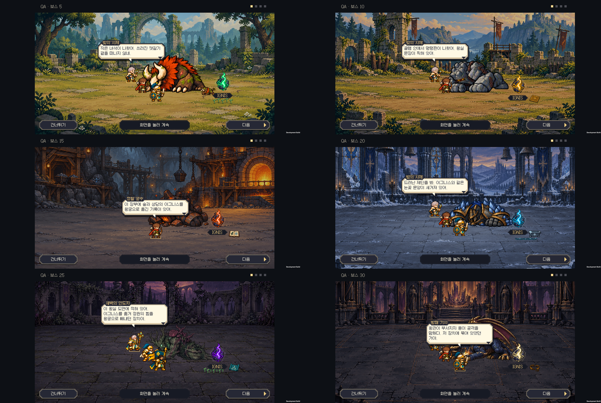
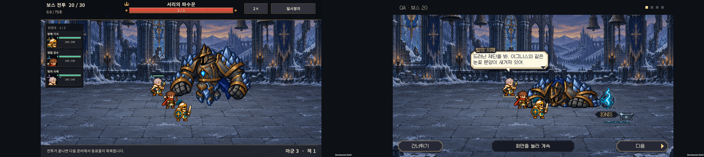
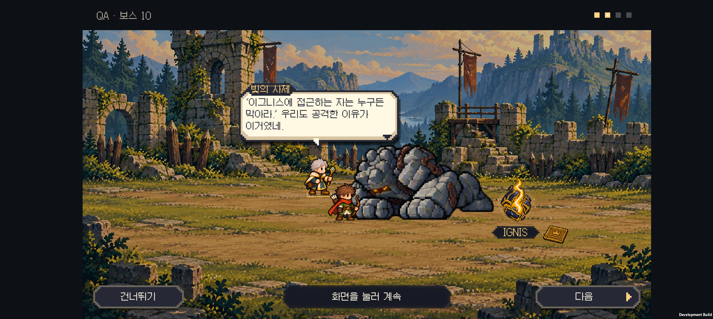
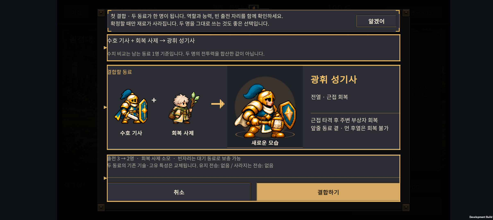
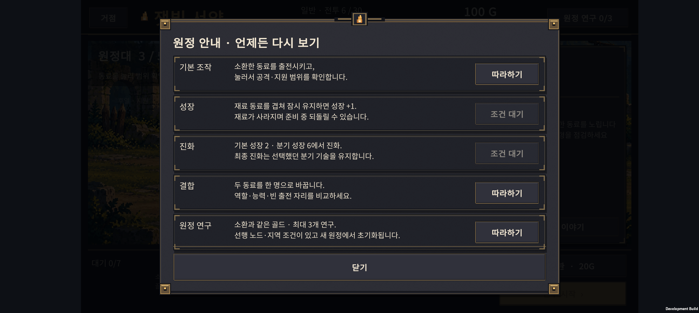

# v0.66 · 처치 후 단서와 이해되는 대화

2026-11-01 · IGNIS: ASHEN OATH · 시즌1 스포일러 포함

보스와 싸우는 동안 명령판·장부 등의 이야기 소품을 미리 흩어 놓지 않는다. 보스가 쓰러져 진정한 뒤 이그니스와 작은 단서가 함께 드러나고, 동료들이 그것을 보고 말한다. 전투 규칙이나 보상량을 바꾸는 작업은 아니다.

## 처치 후 장면

| 전투 | 이그니스 곁에서 보이는 것 | 대화에서 이해할 사실 |
| --- | --- | --- |
| 5 숲 | 기존 새끼와 새싹 장면 유지 | 잿갈기가 무엇을 지키려 했는지 처음 의문을 품는다. |
| 10 성채 | 왕실 명령판 하나 | 골렘은 사람보다 이그니스를 지키라는 명령을 받았다. 뒷면의 폐광 보관소 이름을 따라간다. |
| 15 폐광 | 반출 장부 하나 | 여러 지역의 핵이 왕궁으로 옮겨졌고, 이후 황폐화 보고가 남았다. 아직 인과관계는 단정하지 않는다. |
| 20 성당 | 작은 눈꽃 제단 | 왕국보다 오래된 기록으로 원래 소유권을 확인한다. 성당의 핵은 남겨 둔다. |
| 25 정원 | 왕실 추출 장치 도면 | 옛 왕실의 약탈과 수호자들의 탈환을 연결한다. 정원의 핵도 남기고 강제 추출을 멈추러 간다. |
| 30 왕궁 | 부서진 구속 왕관 | 용도 장치에 묶여 있었다. 핵을 반환하되 왕국 사람들의 난방과 결계도 지켜야 한다. |

- 단서는 쓰러진 보스 위치에서 정한 이그니스 곁에 놓인다. 전장 한쪽의 고정 위치에 미리 진열하지 않는다.
- 이그니스가 드러날 때 작은 단서도 함께 나타난다. 다음 대사를 눌러야 갑자기 생기던 방식을 없앴다.
- 물건을 보상 아이콘처럼 튀어 오르게 하지 않는다. 제단은 바닥에서 드러나고, 장부·명령판 등은 바닥에 놓인 소품으로 보인다.
- 화면 가장자리와 이그니스 이름, 하단 조작 영역을 피한다. 기존 도트 자산과 지역별 이그니스 색을 유지한다.
- 모션 줄이기에서는 완성된 장면을 바로 보여준다. 승리 보상은 대화 전에 한 번 정산되며, 스킵이나 재시작이 보상을 중복 지급하지 않는다.

## 대사 검토와 수정

기존 대사의 문제는 **무엇을 보고 그런 결론을 내렸는지 연결이 약한 것**이었다. 시적인 결론을 먼저 말하거나 화면에 없는 소품을 언급하면, 플레이어가 기록을 따로 읽어야 이해할 수 있었다.

여섯 장면의 24줄을 **발견 → 의문/해석 → 다음 행동**으로 다시 썼다. 반전은 15전투에서 의심하고, 20전투에서 원래 소유권을 확인하며, 25전투에서 전체 관계를 설명한다. 왕국 시민까지 악인으로 취급하지 않고 난방·결계라는 현실적인 갈등을 남긴다.

예를 들어 성채에서는 이렇게 말한다.

> “골렘 안에서 명령판이 나왔어. 왕실 문장이 찍혀 있어.”
>
> “‘이그니스에 접근하는 자는 누구든 막아라.’ 우리도 공격한 이유가 이거였네.”
>
> “사람보다 이그니스를 먼저 지키라는 명령이군.”
>
> “뒷면에 폐광의 보관소 이름이 있어. 그곳의 장부를 찾아보자.”

[현재 대사 전체](dialogue-script.md) · [세계관 기준](../story-direction.md)

이야기 기록도 같은 결정을 따른다. **숲·성채·폐광의 세 핵은 회수, 성당·정원에서는 현지에 남김, 왕궁에서는 추출을 멈춘 뒤 먼저 회수한 핵의 반환을 시작**한다. 이전 기록의 ‘성당의 핵을 챙긴다’와 새 대사의 모순을 수정했다.

## 첫 결합 안내

첫 성장·진화·연구 안내는 이미 있었다. 이번에는 결합 가능한 실제 재료가 생겼을 때 첫 결합 안내를 추가했다.

- 강조된 ‘결합 가능’ 버튼으로 결과를 열고, 확정 전에 모습·능력·빈 출전 자리를 확인한다.
- ‘두 명이 한 명으로 줄어든다’, ‘두 명을 그대로 쓰는 것도 좋은 선택이다’를 명시한다. 결합을 강제하거나 무조건 이득이라고 설명하지 않는다.
- 미리보기·안내 확인·건너뛰기는 골드나 유닛을 소비하지 않는다. 기존 확정과 준비 중 되돌리기를 유지한다.
- ‘조작 안내’에서 다시 볼 수 있다. 안내를 본 상태는 별도 선택 필드로 저장하여 기존 세 항목 비트와 이전 저장 데이터를 유지한다.
- 연구 안내의 조사 오류를 고치고 비용·지역 해금 조건·이번 원정에서만 유지됨을 알린다.

## 정상 원정 진행 비교

현재 `normal-052` 규칙으로 **144개 새 원정, 실제 진행 전투 3,241회**를 자동 실행했다. 체력·골드 보정 없이 소환·성장·진화·결합·연구 API를 사용하고 남은 기회를 소모하면 종료한다. 전투 내부 계산은 실제와 같은 1/60초 틱이다.

- 구성: 시작 편성 4종 × 최종 진화/H-04/H-05 운용 3종 × 연구 경로 3종 × 시드 4개(66501–66504).
- 완주: **31/144(21.5%)**. 고정 정책의 결과이며 일반 플레이어의 완주율·소요 시간 추정치가 아니다.
- 별도 **6,259회**는 같은 편성으로 인접 전투를 비교한 격리 전투다. 정상 진행 전투 수나 완주 수에 더하지 않는다.
- 이 정책은 연구를 11전투부터 구입하며, 모든 합리적인 플레이·배치·소비 순서를 대표하지 않는다. 각 전투 수치는 그 전투에 도달한 원정의 첫 시도 기준이다. 재도전 성공은 전체 완주에 포함된다.

| 우선 확인할 전투 | 도달한 원정의 첫 시도 승리 | 관찰 |
| --- | --- | --- |
| 15 | 72/125 · 57.6% | 시간 초과 33건. 피해를 못 버티는 경우와 화력이 모자라는 경우를 나눠 조정해야 한다. |
| 18 | 68/95 · 71.6% | 시종 집중 공격 구간의 생존 압박. 시간 초과는 없었다. |
| 19 | 50/80 · 62.5% | 보호막 지원이 더해지며 추가 실패. 역시 시간 초과는 없었다. |
| 25 | 45/64 · 70.3% | 후열 분산과 중독 대응을 확인할 구간. |
| 29 | 26/46 · 56.5% | 최종 보스 직전 일반전이 큰 장벽이다. |
| 30 | 29/36 · 80.6% | 여기까지 도달한 편성만의 조건부 수치. 이것만으로 마지막 보스가 쉽다고 단정할 수 없다. |

첫 두 전투는 안내 구간이며, 지역 첫 전투에는 숨을 돌릴 여유가 있다. 모든 전투를 똑같이 어렵게 만들기보다 위 구간과 소비·편성 선택의 관계를 먼저 확인한다. **이번 변경에서 난이도 수치는 조정하지 않았다.**

[요약 데이터](normal-flow.json) · [전체 비교 데이터](normal-flow-raw.json)

재현: `tests/DifficultyCurve/run.ps1 -FirstSeed 66501 -Count 4 -ReportPath '.local-tools/v066/normal-flow.json'`

## 검증과 다음 순서

- 코어 이야기 62개, 학습·결과 처리 5,744개, 계정 저장 150개 검사 통과.
- Unity: 새 단서 배치·결합 안내·저장 호환 143개, 기존 학습 UI 20개, 대화 609개, 엔딩 214개 검사 통과. Android 빌드 성공.
- Galaxy Buddy2: 6종 × 기본/모션·섬광 줄이기 **12개 장면 통과**, 84장과 검수 영상 확보. 성채·성당·왕궁은 2×, 나머지는 1×로 확인했다. 이 장면 검수는 보스 체력 1인 별도 전투이며 위 정상 원정 밸런스 표본과 섞지 않는다.
- 휴대폰에서 첫 결합 안내의 두 번째 줄 잘림과 ‘알겠어’를 가로채던 뒤쪽 상세 버튼을 발견해 수정했다. 최종 APK에서 안내 확인 → 상세 능력 → 취소 → 안내 메뉴 → 연구 다시 보기를 실제 터치하고, 원정 데이터가 그대로이며 재시작 뒤 안내 확인 상태가 유지되는 것을 대조했다.
- 최종 APK에서 정원 대화의 다음/스킵을 실제 터치해 다시 확인했다. 이야기 12장면 캡처 후 마지막 변경은 안내창 여백과 버튼 처리뿐이다.
- 테스트 전의 원정 저장과 설정을 바이트 단위로 복원·검증했다. 전체 84장 원본은 로컬 검수 폴더에 보관하고, 아래에는 대표 화면을 수록했다. HTML은 소스·링크만 확인했으며 브라우저 렌더링은 검증하지 않았다.
- [기기 사례](device-cases.json) · [검증 로그](verification.log) · [APK 정보](build-info.json) · [보스 장면 영상](story-flow-review.mp4)
- 다음 난이도 작업은 15전투의 시간 초과와 18~19전투의 생존을 나눠 비교한다. 무조건 체력이나 적 수를 올리는 방식은 피한다.
- 다음 아트 후보는 성채의 기본 공격 전용 한팔 자세와 후반 기술 사이 연결 프레임이다. 이번에는 소품 이미지를 새로 생성하지 않았다.

## 실기기 대표 화면

왼쪽부터 숲·성채 / 폐광·성당 / 정원·왕궁. 전체 대본은 위 링크에서 읽을 수 있다.

성당 전투 중에는 이야기 소품이 없고, 파수꾼이 쓰러진 뒤 이그니스와 작은 제단이 함께 나타난다.

