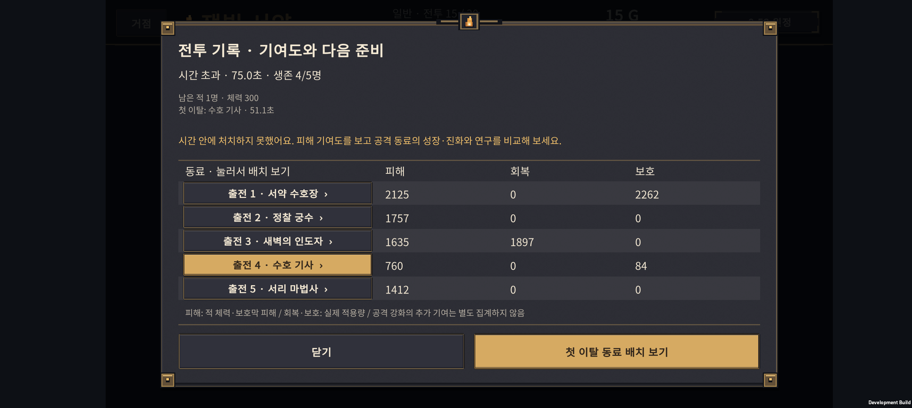
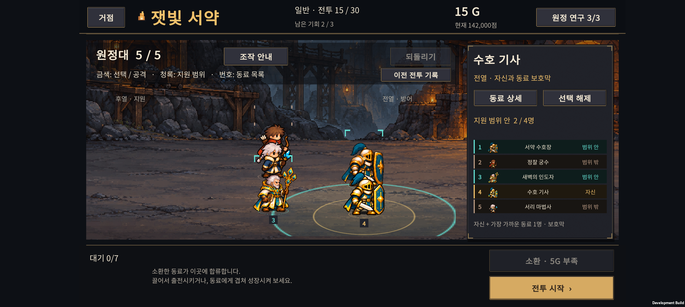
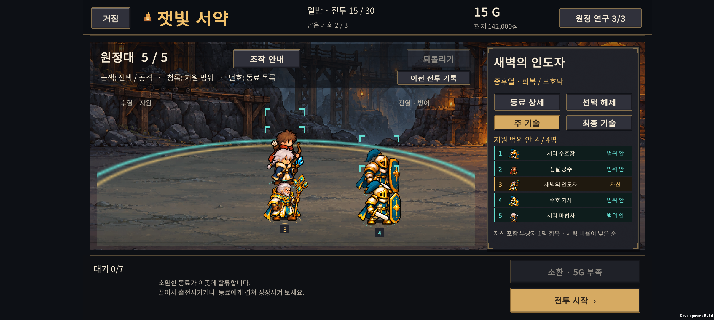

# v0.68 · 후반 난이도 비교와 패배 후 재도전 연결

2026-11-01 · IGNIS: ASHEN OATH

**전투 기록의 동료를 눌러 준비 화면에서 바로 선택할 수 있게 했다.** 후반은 정상 원정 336회와 별도 동일 투자량 비교로 점검했다. 24·29전투의 압박 완화, 25전투 정원 보스의 시간 제한 부담을 다음 조정 후보로 확인했다. 이번 버전에서 적·유닛·연구 수치와 보상은 변경하지 않았다.

## 패배 기록에서 실제 준비로

1. 패배 결과에서 **전투 기록**을 연다.
2. 동료 이름을 누르면 같은 전투의 준비 화면으로 이동하고 해당 동료를 선택한다. **첫 이탈 동료 배치 보기** 버튼으로도 이동할 수 있다.
3. 전장에서 선택 표시·공격/지원 범위를 보고 위치를 옮기거나, 오른쪽 **동료 상세**에서 성장·진화 정보를 확인한다. 성장은 기존 재료와 골드를 사용하는 조작을 그대로 따른다.
4. 준비 화면의 **이전 전투 기록**으로 돌아가 다른 동료도 비교할 수 있다. 결과에서 일반 **같은 전투 재도전** 버튼을 먼저 눌러도 기록을 다시 열 수 있다.

같은 직업이 두 명 있어도 실제 유닛 ID로 연결한다. 기록에서 선택하거나 다시 읽는 것은 골드·남은 기회·난수 상태·배치·성장을 바꾸지 않으며 전투를 자동 시작하지 않는다. 이미 결과 처리 때 소모한 기회를 다시 차감하지 않는다.

전투 기록은 이번 앱 실행 중 데이터다. 앱 재실행 뒤 상세 기록이 없거나, 새 원정/새 전투로 넘어갔거나, 남은 기회를 소진했으면 잘못된 재도전 연결을 제공하지 않는다. 재도전 준비 중 재료로 소비되었거나 출전에서 뺀 동료는 이전 기록에서 바로 선택할 수 없다.

## 후반 비교의 범위

| 구분 | 규모 | 목적 |
| --- | ---: | --- |
| 정상 규칙 새 원정 | **336회 · 실제 진행 전투 6,253회** | 실제 소환·성장·결합·연구 지출과 남은 기회를 사용해 어디까지 가는지 확인 |
| 정상 도달 편성의 격리 재전투 | **3,938회 · 기준 편성 1,004개** | 동일 편성으로 이전/다음 적 편성 또는 밀집/분산 배치만 비교 |
| 동일 투자량 편성 비교 | **10,692회** | 결합 6종·결합 없는 공격형 3종 × 동료 구성 3종 × 투자량 3단계 × 연구 6경로 × 배치 2종 × 20–30전투 |

정상 원정은 시작 편성 4종 × 운용 정책 7종 × 연구 경로 3종 × 성장 우선순위 2종 × 시드 2개다. 68101–68102를 사용했고 65/336개 조건이 완주했다. 같은 시드를 여러 정책이 공유하고 후반 도달 편성은 초중반을 통과한 집단이다. **이 숫자를 일반 플레이어의 승률이나 완주 확률로 해석하면 안 된다.**

동일 투자량 비교는 출전 5명, 소환 재료 23/27/35개, 연구 140G를 맞췄다. 결합형은 최종 진화형보다 재료가 1개 적게 들어 그 차이를 전열 기사의 군기 특성 전수에 사용했다. 원하는 동료를 얻기까지의 무작위 소환 비용이나 남는 대기석 재료까지 같다는 뜻은 아니다. 선택한 진화 분기와 두 배치만 비교했으며 최적 빌드 탐색은 아니다.

처음 탐색한 7,128회 비교는 낮은 투자량만 포함했고 결합의 남는 재료를 당장 능력이 오르지 않는 성장치에 사용했다. 그 결과는 위 최종 집계에서 제외하고, 실효성 있는 특성 전수와 충분한 투자 단계를 포함한 비교로 대체했다.

## 20–30전투: 순서에 따른 압박

아래는 **매 전투에 동일한 972개 조건**을 적용한 통제 비교다. 투자량 세 단계를 섞은 결과이므로 실제로 그 전투에 도달하는 사람의 난이도와는 다르다. 평균 잔여 체력은 전멸한 동료의 0%를 포함한 5명 평균이다.

| 전투 | 유형 | 승리 / 972 | 시간 초과 | 평균 잔여 체력 |
| --- | --- | ---: | ---: | ---: |
| 20 | 서리 보스 | 346 | 41 | 22.9% |
| 21 | 정원 일반 | 972 | 0 | 92.6% |
| 22 | 정원 일반 | 946 | 0 | 76.7% |
| 23 | 정원 일반 | 601 | 0 | 40.9% |
| 24 | 정원 정예 | 722 | 2 | 55.7% |
| 25 | 정원 보스 | 197 | 134 | 11.4% |
| 26 | 왕궁 일반 | 972 | 0 | 87.5% |
| 27 | 왕궁 일반 | 850 | 0 | 65.2% |
| 28 | 왕궁 일반 | 416 | 0 | 29.6% |
| 29 | 왕궁 정예 | 511 | 4 | 39.6% |
| 30 | 마지막 용 | 262 | 65 | 20.8% |

**21·26전투의 완화는 보스 직후 새 지역의 첫 전투라는 역할을 고려해야 한다.** 매 전투가 앞 전투보다 무조건 더 어려워야 하는 것은 아니다. 반면 보스를 앞둔 정예전인 24·29전투가 직전 일반전보다 느슨해지는 부분은 우선 조정할 가치가 있다.

- **23 → 24:** 동일 972조건에서 패배→승리 173개, 승리→패배 52개. 평균 잔여 체력도 14.7%p 늘었다.
- **28 → 29:** 패배→승리 114개, 승리→패배 19개. 평균 잔여 체력 10.1%p 증가.
- 편성 정의를 보면 일반전의 **전열 3 + 원거리 3**에서 정예전은 **정예 1 + 전열 2 + 원거리 2**로 바뀐다. 원거리 한 명이 줄면서 지속 압박이 낮아지는 것이 원인 후보다. 아직 이 요소 하나만 바꾼 인과 비교는 하지 않았으므로 단독 원인으로 확정하지 않는다.

정상 도달 편성에서도 체력 기준의 완화가 보였다. 24전투 도달 편성 94개를 그대로 23전투와 비교하면 평균 잔여 체력이 60.8% → 77.2%, 29전투 도달 편성 80개를 28전투와 비교하면 43.6% → 64.1%였다. 다만 승리 수는 각각 94→92, 80→74로 줄어든다. **평균적으로 여유가 늘어도 일부 편성에는 정예가 더 위험하다.** 따라서 모든 결과를 한 방향의 단순 난이도 상승/하락으로 요약하지 않는다.

## 25전투: 정원 보스의 시간 제한 부담

충분한 투자 단계인 재료 35개 조건 324개만 보면:

| 같은 편성·투자량 | 승리 / 324 | 시간 초과 | 평균 잔여 체력 |
| --- | ---: | ---: | ---: |
| 25 정원 보스 | 175 | 57 | 25.2% |
| 30 마지막 용 | 254 | 14 | 51.6% |

정원 보스가 마지막 보스보다 항상 강하다는 뜻은 아니다. 이 조합·연구·배치 표본에서는 **정원이 더 강한 화력·생존 검사를 요구했다.** 정상 진행에서는 해당 구간에 도달한 편성이 이미 강해서 25전투 첫 시도 85/94승·시간 초과 0회였다. 두 결과의 차이는 도달 집단과 투자 선택의 차이이며 모순이 아니다.

다음에는 정원 보스의 체력·지원 적·회복/보호 상호작용 중 하나씩 바꿔 시간 초과가 줄어드는지 확인해야 한다. 첫 비교만 보고 보스 전체를 일괄 약화하거나 제한 시간을 늘리지 않았다.

## 특정 결합이나 연구만 정답인가

**현재 표본에서 유일한 필수 결합·연구 경로는 확인되지 않았다. 투자 단계에 따른 편향은 크다.**

재료 27개 조건의 마지막 용은 성가 기수 중심 편성에서만 8/36개 승리가 있었고 다른 8개 중심 편성은 0/36이었다. 재료 23개는 전부 패배했다. 낮은 투자량만 검사했다면 성가 기수가 필수라는 잘못된 결론을 내릴 수 있었다.

재료 35개, 연구 140G 조건에서는 결합 없는 최종 진화 편성을 포함해 전부 승리 사례가 나왔다. 아래 각 행은 동료 구성 3종 × 연구 6경로 × 배치 2종, **36조건**이다.

| 중심 동료 | 25전투 승리 / 36 | 30전투 승리 / 36 | 30전투 시간 초과 |
| --- | ---: | ---: | ---: |
| 황혼 명사수 · F-AR | 18 | 29 | 0 |
| 잿불 대마법사 · F-FI | 18 | 28 | 0 |
| 서리 감시자 · F-IC | 12 | 24 | 0 |
| 잿불 검위 · H-01 | 24 | 32 | 0 |
| 광휘 성기사 · H-02 | 24 | 36 | 0 |
| 빙결 추적자 · H-03 | 13 | 25 | 2 |
| 융해술사 · H-04 | 18 | 24 | 2 |
| 성가 기수 · H-05 | 30 | 26 | 10 |
| 원정 유격대장 · H-06 | 18 | 30 | 0 |

성가 기수는 낮은 투자에서 생존을 받쳐 주지만, 충분히 투자한 마지막 용에서는 시간 초과가 10조건 있었다. 광휘 성기사의 36/36 결과 역시 이 표본의 강점이며 전체 상황에서 무조건 최적이라는 증거는 아니다. 보스마다 유리한 역할이 달라지는 점은 살린다.

재료 35개 조건의 여섯 연구 경로는 마지막 용에서 각각 **38–45/54조건**을 이겼다. 하나의 경로만 승리하는 구조는 아니었다. 지금 검사한 것은 방어/정밀/비전 두 단계와 다른 계열 첫 단계를 섞은 동일 비용 경로다. 모든 노드와 혼합 경로의 우열을 검증한 것은 아니다.

## 적용 범위와 검증

- 전투 수치, 골드, 보상, 소환·결합·연구 규칙은 그대로 **normal-067 / Rules 6 / Run Save 14**다. 기존 점수와 진행 원정의 규칙도 바꾸지 않았다.
- 전투 기록 Core 검사 **17개 통과**. 같은 직업 둘 중 실제 첫 이탈 ID를 확인하는 검사를 포함한다.
- Unity 재도전 흐름 **51개 검사 통과**, Android 빌드 성공. 같은 전투 유지, 자원·난수·되돌리기 상태 보존, 중복 선택, 일반 재도전 버튼 경유, 없는 동료·승리·기회 소진·이전 원정 기록 차단을 확인했다.
- Buddy2 화면과 실제 터치 확인 결과는 [실기기 검증](device-verification.md)에 기록한다. 초기 확인에서 재도전 문구와 기존 범위 설명이 겹친 부분은 한 줄 설명과 별도 기록 버튼으로 정리했다.

[전체 요약 데이터](comparison-summary.json) · [재현 방법](../../tests/LateGamePressure/README.md)

## 커뮤니티 공개 준비

[레딧 게시 방향·게시처 조건·영문 초안](community-posting.md)을 함께 작성했다. 첫 영상의 구성, r/IndieDev 소개 글, 무료 테스트 모집 글, 국내 커뮤니티 소개와 예상 댓글 답변을 담았다. AI 사용·현재 한국어 UI·개발 중인 상태를 사실대로 설명한다. 실제 글은 게시하지 않았다.

## 다음 조정 순서

1. **24·29전투:** 원거리 한 명 추가 또는 정예 압박 보완을 서로 별도 후보로 비교한다. 직전 일반전보다 긴장감이 늘면서 취약한 편성이 갑자기 전멸하지 않는지 본다.
2. **25전투:** 시간 초과 57조건을 피해·회복·보호 기여도로 나눠, 보스 체력이나 특정 상호작용 하나만 조정하는 후보를 시험한다. 마지막 용과 충분한 투자량에서 다시 비교한다.
3. **외부 첫 플레이:** 짧은 전투 소개 영상을 준비한 뒤, 읽을 수 있는 언어의 테스트 빌드로 “패배 후 무엇을 바꿀지 이해했는가”를 실제 사람에게 확인한다. 자동 전투 수만 늘리는 것으로 조작 이해도 검증을 대신하지 않는다.
