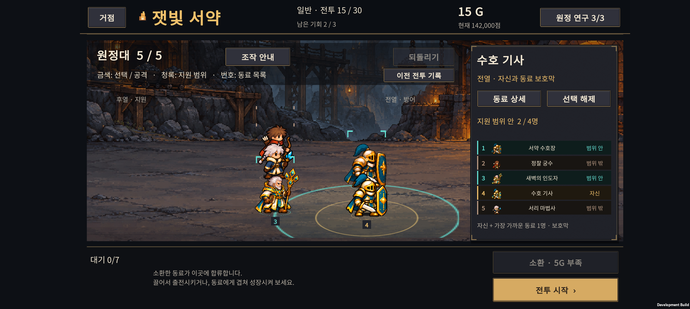
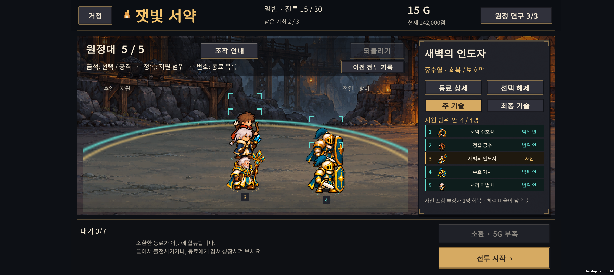
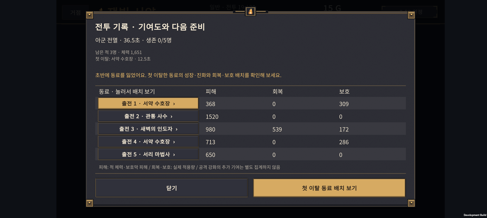

# v0.68 실기기·빌드 검증

2026-11-01 · Galaxy Buddy2 / SM-M236L · 2408×1080 가로 화면

## 최종 빌드

- Unity 6000.3.24f1 / Android Development APK.
- `RetryReviewValidation.ValidateAndBuild`: **51 checks PASS**, `Build Finished, Result: Success.`
- APK: `unity/Builds/Android/expedition-combat-prototype.apk` (301,288,411 bytes).
- SHA-256: `0246C1A05D2B8BE9C1FFE097B29155E5D4BFE379FEAC6803A3C594950C2E3AF6`.
- 이 APK는 개발 검증용이며 스토어 배포 완료를 의미하지 않는다.

## 화면 검사

기존 정상 진행 체크포인트로 실제 Core 전투를 재생하고, 결과·기록·재도전 준비를 실제 게임 UI로 표시했다. 저장 쓰기를 막는 명시적 개발용 검증 모드이며, 검증 후 기존 화면 상태를 복구한다.

18장 캡처:

- 15전투 시간 초과, 18·19전투 전멸, 18전투 승리의 결과·기록 8장.
- 패배 3종의 첫 이탈 동료 선택·기록 재열기·회복 동료 선택 9장.
- 상세 기록이 없는 경우의 안내 1장.

처음 캡처에서 새 재도전 안내와 기존 지원 범위 설명이 같은 줄에 겹쳤다. 중복 안내를 제거하고 기존 설명의 폭과 기록 버튼을 분리한 뒤 다시 빌드·설치해 확인했다. 동료 이름·하단 버튼·범위 안내·오른쪽 동료 상세에서 해당 겹침과 글자 잘림이 보이지 않는다.

## 실제 터치

자동 함수 호출과 별도로 다음 경로를 실제 Android 터치로 확인했다.

1. 패배 결과의 **전투 기록** 열기.
2. **출전 4 · 수호 기사** 행 또는 하단 **첫 이탈 동료 배치 보기** 누르기. 두 경로를 각각 확인했다.
3. 준비 화면에서 해당 유닛의 선택 표시와 지원 범위 확인.
4. **이전 전투 기록** 다시 열기.
5. 세 번째 행의 회복 동료 **새벽의 인도자** 선택 → 해당 지원 범위 표시.

최종 빠른 선택 버튼 경유 로그:

```text
15:46:52 RETRY_AUDIT_OPEN_READY
15:46:54 RETRY_AUDIT_FOCUS_READY
15:46:55 RETRY_AUDIT_REOPEN_READY
15:47:22 RETRY_AUDIT_SECOND_READY
15:47:23 RETRY_AUDIT_TOUCH_PASS
```

일반 **같은 전투 재도전** 버튼에서 준비로 넘어가도 기록을 다시 열 수 있는 조건은 Unity 회귀 검사로 확인했다. 유닛 상세와 재료를 소비하는 실제 성장 동작 전체를 이번 터치 경로에서 다시 검사한 것은 아니다.







## 데이터 보존

검증 전에 기존 계정 저장 2슬롯·손상 보관본의 존재 여부·PlayerPrefs를 백업했다. 종료 후 존재 여부와 내용을 복원하고 **바이트 단위 일치**를 확인했다. 이번 검증의 명시된 임시 체크포인트·캡처·플래그만 정리했고 앱은 종료한 상태다. 새 APK 설치는 유지했다.

게임 난이도 조정이나 플레이어 저장 상태 변경 없이 UI를 확인했다. 51개 Unity 검사에서는 준비로 넘어갈 때 Phase 외에 골드·남은 기회·편성·난수·되돌리기 기록이 그대로인지 비교했다.
