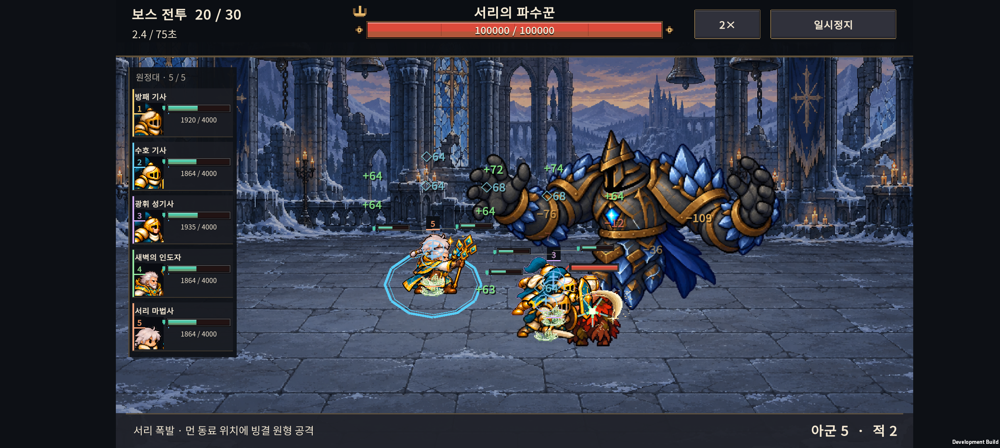

# v0.70 · PixelFX 전투 효과 3종

2026-11-07 · IGNIS: ASHEN OATH

검 타격·회복·빙결을 코드 기반 픽셀 스프라이트로 바꿨다. 기존 전투 수치, 공격 판정, 유닛 그림은 유지한다. 비교 페이지는 표현 검토용이며, 실기기 영상은 체력을 높인 QA 편성이다.

- [기존 / 적용 비교 화면](effects-preview.html) — 1×·2×, 밝은/어두운 배경, 섬광·모션 줄이기.
- [Buddy2 실제 전투 영상 · 18초](device-evidence/pixelfx-buddy2.mp4)
- [자동 실기기 결과](device-evidence/report.json)

## 적용

| 효과 | 처리 |
| --- | --- |
| 근접 타격 | 기존 근접 명중 표시를 금빛 궤적 8프레임으로 교체. 0.24초 재생하며 좌우 방향 반영. 기존 근접 스킬에도 사용한다. |
| 회복 | 연녹색 입자 16프레임, 0.64초. 실제 회복 이벤트에서 시작하고 대상의 이동을 따라간다. 보호막은 기존 표시 유지. |
| 빙결 | 캐릭터 중심을 비운 회청색 결정 16프레임. 빙결 상태에만 표시하고 마지막 0.12초에 사라진다. 모션 줄이기에서는 정지 프레임 사용. |

세 시트는 합계 약 38.5 KiB PNG, 비압축 RGBA 기준 약 1.32 MiB다. 런타임에서는 캐시한 텍스처의 UV만 선택한다. 새 텍스처나 별도 파티클 시스템을 매 프레임 생성하지 않는다. 기존 효과 기록의 최대 24개 제한을 유지한다.

## 검증

- Unity 편집기 검사 통과: 40개 유효 프레임, 투명한 2픽셀 셀 경계, Point/Clamp/비압축/밉맵 없음, 회복과 보호막의 분리, 일시정지와 효과 만료.
- Android IL2CPP 개발 APK 빌드 및 Galaxy Buddy2 설치 완료.
- 같은 편성으로 각각 시뮬레이션 32초: 1×, 2×, 섬광·모션 줄이기 2× 모두 기본 공격 이벤트 147회 / 회복 31회 / 빙결 8회. 런타임 예외 없음.
- 저장 파일 및 PlayerPrefs를 테스트 전 백업하고 종료 후 바이트 단위로 복원 확인.
- 밝고 어두운 배경의 비교 화면과 실기기 캡처 확인. 녹화·ReadPixels 캡처를 포함한 짧은 개발 빌드 검사이므로 기록된 프레임 시간은 정식 성능 벤치마크로 사용하지 않는다.

## 출처와 재생성

[PixelFX](https://github.com/patch-gg/pixelfx) `a84159688af3ca37a4be05a0d422b94451b2e24e`를 고정 사용했다. 검·회복은 해당 효과의 팔레트·광량·샘플링을 조정했다. 회복의 기본 인체 마스크를 비웠고, 빙결은 PixelFX Painter로 우리 게임용 결정 형태를 그린 것이다. 이미지 생성 모델을 새로 사용하지 않았다.

MIT 라이선스와 저작권 고지는 `unity/Assets/Resources/Art/Effects/v070/`에 함께 포함한다. 갤러리 전용 폰트는 포함하지 않는다. 재생성 절차는 [tools/pixelfx](../../tools/pixelfx/README.md)에 있다.

## 후속 관찰

- 빙결 상태는 지속되는 결정 표시로, 보스가 타격할 때의 큰 얼음 폭발과 별개다. 상태 표시와 기존 보스 이펙트가 함께 나오는 장면은 사용자 선호에 따라 더 조절할 수 있다.
- 후속 수정: 사용자 요청에 따라 왼쪽 아군 목록의 일반 공격/투사체 활동 색 띠를 제거했다. 고정 번호·고유 색, 체력·보호막·상태 이상, 눌렀을 때 동료 위치 강조는 유지한다. 위 영상과 캡처는 이 후속 수정 전의 PixelFX 검증 자료다.
- 검 궤적은 현재 검 전용 판정이 아닌 기존 근접 타격의 공통 표시다. 맞은 대상 위치에서 재생되므로 아군이 때리면 적에게, 적이 때리면 아군에게 보인다. 무기별 효과 구분은 아직 적용하지 않았다.
- 이번은 세 효과의 시험 적용이다. 보스 전체 효과나 모든 기술을 PixelFX로 교체한 것은 아니다.
