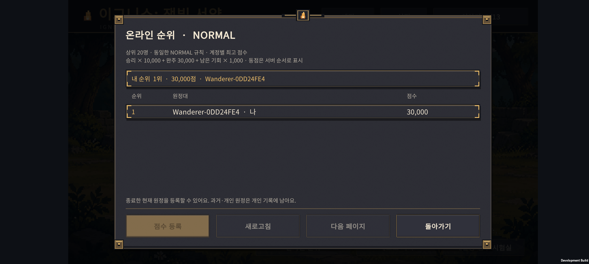
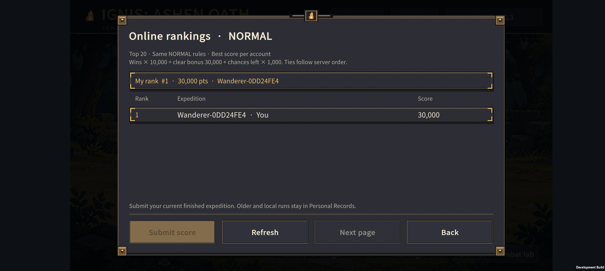

# v0.73 — 온라인 순위와 서버 점수 검증

2026-11-07. v0.72 계정 연결·클라우드 저장은 `d9f62cb`로 커밋하고 GitHub `main`에 푸시했다. 아래 v0.73은 그 다음 개발 내용이다.

## 플레이어에게 보이는 변화

- 홈 하단과 계정 창에 **온라인 순위**를 추가했다. 상위 20명과 내 순위를 볼 수 있고 한 화면에는 5명씩 표시한다.
- GUEST는 그대로 플레이할 수 있다. 순위 조회·등록에는 Google 로그인이 필요하다.
- 새 원정 창에서 **온라인 시작 / 개인 원정 시작**을 고를 수 있다. 전투 규칙은 둘 다 같은 NORMAL이다. 온라인 시작 때 서버가 시작 조건을 발급하며, 이후 원정 진행은 로컬에서 이루어진다.
- 종료한 현재 원정은 순위 창의 **점수 등록**으로 제출한다. 다음 온라인 원정을 시작할 때도 종료한 현재 기록을 먼저 제출한다. 계정별 최고 점수만 유지한다.
- 기존 원정·개인 원정은 개인 기록으로 남는다. 이미 진행한 기록을 소급해서 온라인 순위에 올리지는 않는다.
- 공개 이름은 `Wanderer-XXXXXXXX` 형식의 임시 별칭이다. Google 이름·이메일은 순위에 표시하지 않는다.
- 새로고침은 30초 간격이며, 요청이 25초를 넘으면 실패 안내 후 화면 조작을 돌려준다. 통신 실패가 기존 저장을 지우지 않는다.

## 점수와 공정성

점수 공식은 기존과 같다: **승리 × 10,000 + 30전투 완주 30,000 + 남은 기회 × 1,000**. 동점은 서버 순서로 표시한다. 현재는 점수 세분화나 주간 도전, HARD 순위를 추가하지 않았다.

클라이언트가 계산한 점수를 그대로 올리지 않는다. 서버가 발급한 시작 조건과 소환·이동·강화·진화·결합·연구·되돌리기·전투 기록으로 실제 원정을 재현하고, 승패와 점수를 다시 계산한다. 순위 서비스에 직접 점수를 쓰거나 목록을 읽는 Player 요청은 차단했다. 계정 백업용 Cloud Save 본문과 검증 근거를 분리했다.

계정당 현재 온라인 원정 하나만 검증 대상으로 둔다. 새 온라인 시작은 미완료 티켓을 대체한다. 여러 기기에서 서로 다른 원정을 동시에 시작하는 동작은 출시 전 추가 보완 대상이다.

## 검증 결과

- **49개 원정과 재현, 557개 검사 통과**: 네 시작 편성, 소환·배치·강화·진화·결합·연구·되돌리기, 전투 중 저장/복원, 잘못된 명령·승패·소유자·티켓·크기 제한 거부.
- 기존 로컬 저장 **150개 검사·90개 여정 체크포인트**, 계정 동기화 **142개 검사**, 한영 번역 **4,961개 검사** 통과.
- Unity **20개 검사**: 실제 JSON 직렬화와 재현, 종료 후 이어가기의 제출 내용 유지, 기록 중복 크기 방지, 한영 문구 높이와 창 중앙 정렬. 기존 계정 창 **32개 검사**도 통과.
- UGS **development**에 실제 모듈·순위표·접근 정책 배포. 유료 플랜이나 결제 수단을 활성화하지 않았다. production은 변경하지 않았다.
- Buddy2 정상 Google SDK 세션으로 실제 조회 성공. 별도 자동 전투 원정의 **30,000점**이 Android와 서버에서 같았고, 등록·반복 등록·내 순위 조회가 성공했다. 현재 1위는 이 개발용 검증 기록이며 실제 사용자 경쟁 결과가 아니다.
- 변조한 승패 제출 거부. 순위 서비스에 직접 보낸 읽기·점수 쓰기 요청은 **403**. 익명 계정의 조회·시작·제출도 모두 거부됐다.
- 테스트는 사용자 진행 중인 원정과 별도 인스턴스로 실행했다. 기존 5전투의 원정과 Google 연결은 유지한다.

## 다음 검증

1. 실제 플레이로 온라인 원정 시작 → 중간 종료 → 이어하기 → 패배/완주 → 등록까지 연결한다. 자동 전투의 서버 재현 성공을 30전투 전체 수동 플레이 완료로 표현하지 않는다.
2. 두 물리 기기의 저장 선택·동시 시작·오래된 티켓, 장시간 오프라인과 재로그인을 확인한다.
3. 출시 전에 공개 닉네임, 계정/데이터 삭제, 개인정보처리방침, 정식 OAuth·서명, 사용량 제한과 악용 방지를 마무리한다.

서버 구조와 배포 방법: [server/README.md](../../server/README.md). APK: `unity/Builds/Android/expedition-combat-prototype.apk`.
