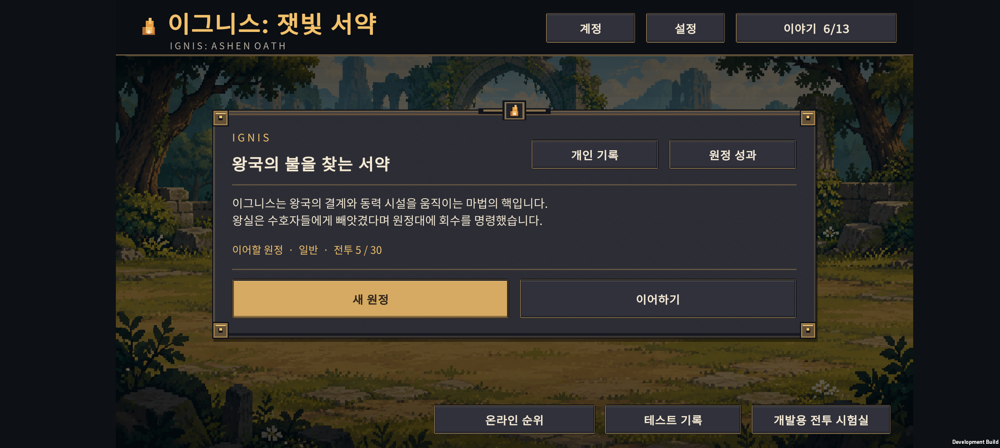
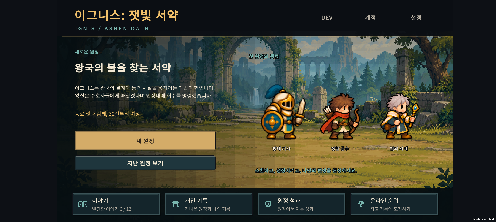
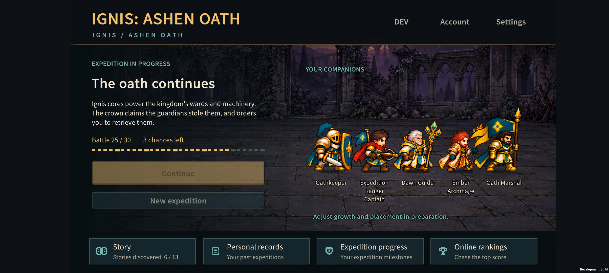
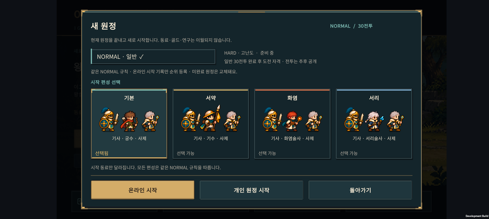
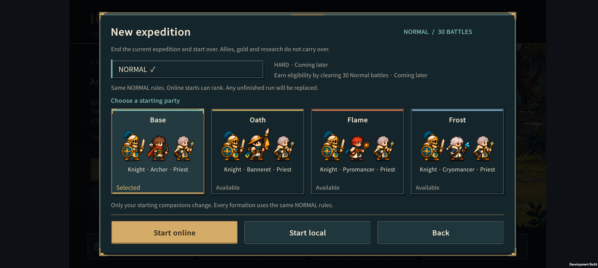
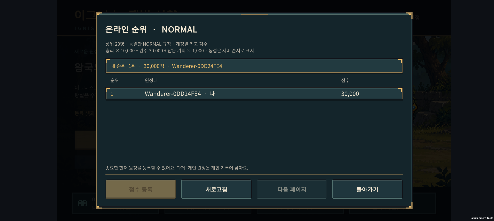

# v0.74 — 동료가 보이는 메뉴

2026-11-07. 온라인 순위 v0.73은 `dd78402`로 커밋하고 GitHub main에 푸시했다. 이후 홈·새 원정·공통 UI의 시각 구성을 수정했다.

## 적용 내용

- **홈:** 중앙의 큰 설명창을 없애고 왼쪽에는 원정 진행과 행동, 오른쪽에는 실제 출전 동료를 배치했다. 진행 중이면 이어하기를 주요 버튼으로 표시한다. 새 플레이에서는 기본 세 동료를, 원정 진행 중에는 실제 출전 편성을 보여준다. 완료한 원정은 새 원정과 지난 결과 보기로 연결된다.
- **지역과 사람 크기:** 진행 지역의 기존 배경을 사용한다. 기존 스프라이트·사람 기준 크기 보정·바닥 피벗을 재사용하며, 깃발과 무기의 외곽으로 사람 크기를 다시 계산하지 않는다. 모션 줄이기를 켜면 메뉴의 대기 동작도 멈춘다.
- **홈 라벨:** 제목·동료 이름·설명의 사각 배경을 제거했다. 얇은 어두운 글자 외곽선과 그림자로 밝은 지면에서도 읽히도록 한다. 배경 밝기를 판별해 컨테이너를 숨기는 방식은 아니다. 동료 이름은 각 캐릭터 바로 아래에 따로 표시하고, 긴 영어 이름은 필요한 줄 수만큼 높이를 확보한다. 설명도 짧게 정리했다.
- **메뉴 구분:** 이야기·개인 기록·원정 성과·온라인 순위에는 각각 책·기록·방패·트로피 문양과 보조 설명을 넣었다. 계정·설정은 상단에, 테스트 기록·전투 시험실은 개발 빌드의 DEV 메뉴 안에 둔다.
- **새 원정:** 네 시작 편성을 실제 유닛 세 명이 보이는 카드로 바꿨다. 선택 상태는 테두리와 문구로 함께 표시한다. NORMAL 규칙, HARD 준비 중 안내, 온라인/개인 시작과 기존 원정 교체 경고는 유지한다.
- **공통 UI:** 회색 면을 어두운 청록색으로 바꾸고, 일반 패널은 차분한 금속 테두리를 사용한다. 금색은 주요 버튼·선택 상태·창 모서리에 집중한다. 큰 리벳과 반복 불꽃 표식을 줄이고 계단형 모서리와 넓은 색 면을 사용한다.

이번 범위는 메뉴 표현과 탐색 구조다. 전투 수치·연구 효과·소환·결합 규칙·클라우드 및 순위 프로토콜은 변경하지 않았다. 결합 결과 화면의 정보 배치와 연구/순위의 개별 디자인은 다음 개선 대상으로 남아 있다.

## 실제 화면

### 홈

마지막 화면은 저장을 차단한 검사 편성이다. 긴 영어 이름과 어두운 배경의 가독성을 확인하기 위한 화면이며, 실제 원정 진행 상황은 아니다.

### 새 원정

### 공통 창

표시된 30,000점은 이전 온라인 순위 검증에서 만든 개발용 기록이다. 이번에는 순위 조회와 화면 표시만 확인했다.

## 확인 기록

- Galaxy Buddy2에 최종 APK를 덮어 설치하고 실제 화면을 확인했다. 밝은 숲과 어두운 지역 모두 이름표의 사각 배경 없이 표시된다.
- 한국어·영어 메뉴 **26화면 / 26캡처 / 글자 넘침 0건**. 새 플레이·3인·5인·완료 원정 홈, 네 시작 편성, 설정·기록·성과·계정·순위 화면을 포함한다.
- 긴 영어 유닛 이름은 필요한 줄 수에 맞춰 높이를 확보했다. 실제 터치로 편성 선택·취소와 한영 전환을 확인하고 한국어로 되돌렸다. 새 원정 시작이나 기존 원정 교체는 하지 않았다.
- Unity 빌드와 순위 20항목·계정 32항목 검증 통과. 한영 문구 1,047개와 관련 검사 5,015항목 통과.
- 메뉴 검사는 저장을 차단한 상태에서 실행하고 원래 원정·언어를 복원한다. 전체 전투 밸런스나 모든 화면비를 다시 검사한 결과는 아니다.
- 이전 온라인 순위 작업 v0.73의 기준 커밋은 `dd78402`다.

## 관련 코드

- `unity/Assets/Scripts/Presentation/ExpeditionMenuScreen.cs`: 홈·편성 카드·메뉴 문양.
- `unity/Assets/Scripts/Presentation/ExpeditionUiTheme.cs`: 공통 색·버튼·창·패널.
- `unity/Assets/Scripts/Presentation/LocalizationAudit.cs`: menus 모드의 한영 화면 검사. 테스트 편성은 저장 차단 상태에서만 표시하고 종료 후 원래 원정과 언어를 복원한다.
- `content/localization/messages.json`: 한영 메뉴 문구 원본.
- `unity/Assets/Editor/PrototypeSetup.cs`: 반복 UI 확인용 `-ignisIncremental` 빌드 옵션. 기본 빌드는 기존처럼 캐시를 비운다.

APK: `unity/Builds/Android/expedition-combat-prototype.apk`.
