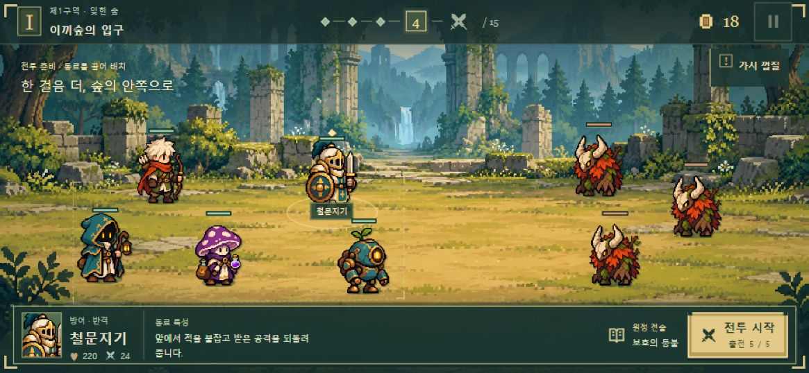

# 잔불 원정대 게임 기획과 디자인 재정립

2026년 10월 19일 · v0.8 검토안 · 개발 가칭 Ember Expedition

**무작위로 만난 동료를 영입하고, 기술을 전승해 강력한 부대를 만든 뒤, 꺼진 봉화로 향하는 길의 보스를 돌파하는 가로형 도트 로그라이트.** 화면은 전장과 지금 필요한 선택에 집중하고, 성장의 결과는 공격 동작과 연쇄 효과로 보여준다.

이 안은 스테이지별 별 수집 중심의 v0.7을 대신할 **새로운 원정 구조 제안**이다. 게임에 적용된 규칙과 구분한다. 중세풍·가로 화면·도트 그림체·조합과 배치, **버튼으로 동료를 무작위 소환하는 방식**은 사용자 선택으로 정했다. 아래의 원정 길이·소환 횟수·패배 규칙·성장 비용은 플레이 검증 전 제안값이다. 개발 기간을 짧게 제한하지 않고 완성도를 기준으로 제작 단계를 진행한다.

[화면 구성 시안 보기](ui-concept.html) · [이전 중세풍 기획](../ember-expedition-design-v0.6.md) · [기존 구현 설명](../../unity/FIRST-SLICE.md)

**후속 상세안:** [직업·진화·결합체 v0.9](../design-v0.9/unit-catalog.html)에서 30형태의 능력치·스킬·전승·결합식을 구체화했다. v0.8의 24형태에 특수 결합체 6종을 추가하는 제안이며, 해당 항목의 상세 규칙은 v0.9를 우선한다.

## 1 우리가 만들 게임과 품질 기준

플레이어는 운 좋게 얻은 동료 한 명을 보고 다음 조합을 상상한다. 동료를 그대로 출전시킬지, 다른 동료에게 경험과 기술을 넘길지 고른다. 전투가 시작되면 방패가 공격을 받아내고, 표식이 다음 적으로 넘어가며, 불꽃이 적 무리를 쓰러뜨리는 모습을 짧고 명확하게 본다. 패배하면 다음 원정에서 바꿀 선택을 떠올릴 수 있어야 한다.

| 기준 | 만들 경험 | 확인할 장면 |
| --- | --- | --- |
| 빠른 선택 | 적은 조작으로 영입과 성장 결정 | 준비 화면에서 다음 행동을 바로 찾는다 |
| 조합의 발견 | 같은 계열도 전승과 진화에 따라 역할 변화 | 이전 원정과 다른 부대가 완성된다 |
| 전투의 손맛 | 준비 동작과 명중, 반응과 소리가 이어짐 | 숫자를 읽지 않아도 강한 공격을 알아본다 |
| 배치의 의미 | 전열과 후열, 거리와 뭉침이 결과에 영향 | 같은 팀을 재배치하면 보스 피해가 달라진다 |
| 다시 할 이유 | 새 진화와 유물, 공략과 지역 발견 | 실패 뒤에도 다음에 시도할 목표가 남는다 |

Android와 Galaxy Buddy2를 기준으로 Unity 6.3 LTS/C# 개발을 이어간다. 상품은 인앱결제 없는 무료 광고판과 별도 유료 무광고판이다. 기존 기사·궁수 시안의 비율과 색감이 미술의 출발점이며, 이름·장비·개별 외형은 출시용 디자인으로 다듬는다.

## 2 Slotbound에서 배우고 개선할 부분

Slotbound 공식 설명에서 확인되는 핵심은 슬롯으로 유닛 획득, 유닛 흡수와 분기 진화, 개체별 능력과 특성, 아이템과 코어, 강한 웨이브와 보스다. 이 요소들이 연결되어 다음 영입에 대한 기대와 부대를 키우는 선택을 만든다. [Steam 공식 설명](https://store.steampowered.com/app/4906570/Slotbound_Demo/)

사용자가 공유한 **2026년 6월 27일 테스트 리뷰**는 초반 유닛 획득 실패, 결과를 조절할 수단 부족, 낮은 유물 효율, 설명과 실제 행동의 차이, 성장 재료 부족을 지적했다. 이는 당시 빌드에 대한 한 플레이어의 경험이며 현재 버전 전체의 평가로 확대하지 않는다. 우리 설계에서는 같은 불편이 생기는지 확인할 사례로 쓴다. [리뷰 원문](https://gall.dcinside.com/mgallery/board/view/?id=game_dev&no=217358)

| 참고할 재미 | 우리 설계의 개선 방향 |
| --- | --- |
| 다음 유닛에 대한 기대 | 최소 영입량을 보장하고, 좋은 결과는 역할·특성·희귀한 조합에서 만든다 |
| 유닛을 재료로 쓰는 판단 | 전승 한 화면에 성장량과 전달 기술을 함께 보여준다 |
| 진화의 큰 변화 | 무기·실루엣·공격 방식이 함께 바뀐다 |
| 강한 조합의 연쇄 | 연결된 행동이 전장에서 순서대로 읽히게 연출한다 |
| 보스의 압박 | 준비 단계에서 위협을 공개하고 두 가지 이상의 대응을 허용한다 |
| 반복 도전 | 한 원정의 부대 성장과 원정 밖 해금이 함께 작동한다 |
| 풍부한 정보 | 기본 화면은 역할과 핵심 행동, 자세한 수치는 탭으로 확인한다 |

Slotbound의 개별 유닛 사망 이후 복귀와 HP 이월 규칙은 이번 조사에서 확정하지 못했다. **4장의 회복과 패배 규칙은 우리 게임에 대한 제안**이다. 도감의 현재 세부 기능도 예정 기능과 섞어 서술하지 않는다. 개발자는 직업 확인 기능을 확장하겠다고 밝혔고, 영구 성장을 보조 콘텐츠로 설명했다. [개발자 답변](https://www.reddit.com/r/roguelites/comments/1uhxn0z/i_spent_8_months_making_my_first_ever_game_a/)

제작에서는 참고작의 재미가 생기는 조건을 분석한다. 캐릭터·아이콘·문구·사운드·애니메이션·화면 배치와 개별 콘텐츠 조합표는 우리 세계관과 조작에 맞게 새로 만든다. 출처 기록과 유사성 검토는 자산별로 유지한다. 이름만 바꾸는 작업을 독자 디자인의 완료 기준으로 삼지 않는다.

## 3 기존 시제품에서 바뀌는 방향

| 항목 | 현재 시제품과 이전 문서 | 새 기획 제안 |
| --- | --- | --- |
| 기본 진행 | 1-1의 2전투, 1-2의 3전투 뒤 지도 복귀 | 한 원정 안에서 여러 전투와 보스를 연속 진행 |
| 지도 | 작은 원형 스테이지와 별 | 지역 선택 및 이번 원정의 진행 표시 |
| 반복 도전 | 특정 짧은 스테이지의 기록 갱신 | 새 원정에서 새 부대와 조합을 구성 |
| 별과 점수 | 스테이지별 저장 | 메인 진행에서 제거. 보스 격파·도감·난이도로 목표 제공 |
| 전투 화면 | 시험용 버튼과 설명이 넓게 상시 표시 | 선택한 대상의 정보만 열고 전투 때 조작 패널 접기 |
| 성장 조작 | 훈련 USE와 전승 PASS 분리 | 전승에 성장 진행과 기술 선택을 묶는 방안 검증 |
| 성장 공급 | 검증용 고정 대기 동료와 승리 보상 | 원정 진행에 따른 최소 영입량 보장 |
| 콘텐츠 | 일부 계열과 기사 진화, 골렘 시험 | 직업·진화·유물·적 행동·보스·지역을 단계적으로 확대 |

지도 자체는 로그라이트와 함께 쓸 수 있다. 지역을 선택하고 그 안에서 새로운 원정을 시작하거나, 원정 중 다음 경로를 고르는 방식이다. 이 안에서는 **개별 전투를 골라 되풀이하는 별 수집을 내려놓고, 한 원정의 누적 선택을 중심에 둔다.** 기존 지도 그림과 지역 이름은 지역 선택과 원정 진행 연출에 다시 사용할 수 있다.

현재 1-1과 1-2는 플레이 가능하며, 1-3은 지도·정보와 데이터만 있다. 골렘 전투와 기사 분기, 훈련·전승은 COMBAT LAB에서 시험한다. 이 상태는 코드와 FIRST-SLICE 문서를 기준으로 확인했다. v0.7은 당시 설계 이력으로 보관하고 현재 구현 설명과 구분한다.

## 4 원정 한 판의 구조

**거점 → 지역과 시작 편성 선택 → 영입·전승·배치 → 자동 전투 → 다음 준비 → 중간 보스 → 최종 보스 → 원정 결과와 영구 해금**

### 원정 길이와 전투 배치

일반 원정은 **12전투, 4·8·12번째 보스**를 초기값으로 삼는다. 앞의 두 보스는 작은 조합 시험, 마지막 보스는 완성된 부대를 시험한다. 첫 튜토리얼과 제작 검증은 6전투로 압축하되, 이를 최종 콘텐츠 분량으로 간주하지 않는다.

| 구간 | 목적 | 첫 원정의 장소 |
| --- | --- | --- |
| 1~3전투 | 역할 확보와 첫 전승 | 숲길 |
| 4전투 | 첫 진화 또는 다수 편성 시험 | 추적자의 둥지 |
| 5~7전투 | 조합을 강화할 기술과 유물 결정 | 무너진 초소 |
| 8전투 | 후열 공격과 배치 시험 | 초소 지휘관 |
| 9~11전투 | 조합의 약점 보완과 최종 진화 | 폐성 외곽 |
| 12전투 | 두 가지 이상의 기믹을 가진 최종 보스 | 성문 골렘 |

일반 전투 20~35초, 보스 40~70초, 준비 20~35초를 우선 목표로 잡는다. 12전투의 전투·준비 합계는 약 9~16분이며 전환과 선택 시간을 포함해 **한 원정 12~18분**부터 측정한다. 준비 단계에 제한 시간은 두지 않는다. 긴 원정도 중간 저장으로 나누어 플레이할 수 있다.

### 쓰러짐과 원정 패배

제안 기준은 **전투별 유닛 HP와 원정 전체의 등불 내구도를 따로 관리**하는 것이다. 전투에서 동료가 쓰러져도 다음 준비 때 복귀하고 전원 HP를 회복한다. 보호막·지속 효과·일시 강화·기술 재사용 시간도 새 전투에서 초기화한다. 성장한 직업·전승 특성·유물은 같은 원정에서 유지한다.

등불 내구도는 3으로 시작한다. 일반 전투에서 아군 전멸 또는 75초 제한 시간 도달 시 내구도 1을 잃고 다음 전투로 이동한다. 내구도가 0이 되면 원정이 끝난다. **보스전 패배는 남은 내구도와 관계없이 원정 종료**를 첫 비교안으로 둔다. 보스 실패에도 계속하는 규칙은 별도 실험 후보다.

승리는 제한 시간 안에 적을 모두 쓰러뜨린 경우다. 일반 전투 패배 후에도 다음 준비의 기본 영입을 제공해 회복할 선택지를 남긴다. 보너스 전리품은 승리했을 때만 지급한다. 같은 원정에서 같은 전투를 다시 골라 보상을 반복 획득하지 않는다.

이 규칙의 검증 질문은 두 가지다. 한 번의 실수 뒤 실제로 다시 강해질 수 있는지, 복귀가 너무 관대해서 배치와 방어가 의미를 잃지는 않는지 확인한다. 부족하면 보스 난이도와 등불 비용을 먼저 조정한다. 유닛 영구 사망과 HP 이월은 초반 기본 규칙에 동시에 추가하지 않는다.

### 중단과 저장

준비 진입·소환 확정·전승 확정·전투 시작·결과 확정 시 저장한다. 소환권 차감과 결과 동료 지급은 한 번에 저장한다. 앱을 다시 열면 동일한 소환 결과와 같은 부대 상태를 복구한다. 전투 중 종료되면 저장한 시작 상태와 난수로 해당 전투를 재개한다. 완료 보상과 영구 해금은 중복 지급하지 않는다. ‘이어하기’는 새로 뽑기나 의도적인 전투 재도전 메뉴로 쓰지 않는다.

## 5 영입 방식과 운을 조절하는 선택

**사용자가 선택한 방식은 버튼을 누르면 무작위 동료 한 명이 바로 나오는 소환이다.** 짧은 조작과 뜻밖의 결과를 재미의 출발점으로 삼는다. 전략은 나온 동료를 출전시키고, 전승하고, 누구에게 집중할지를 고르는 과정에서 만든다. 현재 시제품의 후보 3명 중 선택은 구현 이력이며 새 방향과 다르다.

| 순간 | 기본 조작 | 화면에 남길 정보 |
| --- | --- | --- |
| 소환 | 버튼 한 번으로 동료 한 명 확정 | 사용 가능한 소환 횟수 |
| 결과 | 짧은 등장 뒤 대기석에 자동 합류 | 직업·역할·본래 특성 한 줄 |
| 활용 | 동료를 눌러 배치 또는 전승 선택 | 현재 조합에 필요한 효과와 진화 진행 |

### 무작위 소환의 첫 규칙

시작 동료는 방어·공격·지원 3명이다. 첫 편성은 기사·궁수·사제를 제안하되, 기존 시험 조합인 기사·마법사·사제도 비교한다. 첫 원정에서는 역할이 보장된 편성을 제공한다. 이후에는 해금한 시작 편성 중 하나를 고를 수 있다.

2~12전투의 준비마다 **동료 한 명을 소환할 권리**를 기본 지급한다. 소환은 빈 결과 없이 항상 성공한다. 소환권은 해당 준비에서 사용하고 다음 전투 시작 전 미사용 여부를 알려준다. 초기 검증에서는 이월과 유료 추가 소환을 넣지 않는다. 사용하지 않고 넘어가면 그만큼 성장 재료를 덜 얻는다.

첫 검증에서는 해금한 기본 계열을 같은 가중치로 추첨하고, 기본 계열 3종 이상을 소환 목록에 둔다. 무작위 소환에서 같은 계열이 3번 연속 나오면 다음 소환은 그 계열을 제외하는 보정을 제안한다. 보정 규칙과 소환 목록은 버튼의 정보 화면에서 확인할 수 있게 한다. 다음 결과의 난수와 연속 횟수도 저장하므로 앱 재실행이나 전승 되돌리기로 바뀌지 않는다. 세부 확률과 희귀한 개체 특성은 조합 검증 후 추가한다.

등장 연출은 0.4~0.7초부터 시험하고, 탭하면 결과를 즉시 보여준다. 결과 확인을 위해 매번 큰 다이얼로그를 닫게 하지 않는다. 소환 직후 작은 정보 카드와 대기석 강조로 합류를 알린다. 연속 입력이 같은 소환권을 두 번 사용하지 않게 한다. 재뽑기는 첫 규칙에서 제외하고, 원하는 직업이 안 나와도 전승과 배치로 대응할 수 있는지 먼저 검증한다.

좋은 영입의 기준은 희귀도뿐 아니라 현재 조합과의 연결이다. 처음에는 각 계열의 본래 특성만 사용하고, 이해 가능한 조합이 만들어진 뒤 소수의 개체 특성 변형을 추가한다. 최저 등급 동료도 출전·성장 재료·기술 전승 중 하나의 가치가 있어야 한다.

### 성장 재료가 충분한지 확인

12전투에서 시작 3명과 기본 소환 11회를 모두 사용하면 **기본 공급 14명**이다. 출전 5명을 유지하면 성장에 쓸 수 있는 동료는 최대 9명이다. 소환권을 버리거나 중간에 원정이 끝나면 실제 공급은 줄어든다. 보너스 영입은 이 계산에 포함하지 않는다.

첫 진화는 재료 2명, 최종 진화는 첫 진화 이후 재료 4명을 초기값으로 둔다. 최종 진화 한 명에 총 6명, 다른 첫 진화 한 명에 2명을 사용하면 재료 8명과 출전 5명으로 총 13명이다. 기본 공급으로 한 명에게 집중하는 빌드가 가능하다. 다수 편성에서는 재료 8명으로 네 명을 첫 진화시킬 수 있다. 실제로 둘 다 보스를 공략할 수 있어야 한다.

기본 영입이 기능한 뒤 골드 구매와 상점을 붙인다. 골드를 추가할 때는 전투당 수입, 동료 구매가, 유물 가격을 한 표에서 함께 조정하고 기본 공급 14명 위에 몇 명이 추가되는지 다시 검산한다. 새 재화를 여러 개 동시에 넣지 않는다.

## 6 전승과 분기 진화

기존의 훈련과 전승 버튼을 하나의 **전승** 진입점으로 합치는 것을 제안한다. 받는 동료와 보내는 동료를 고르면 진화 진행도와 전달 가능한 특성이 한 화면에 나온다. 플레이어는 성장 진행을 받으면서 특성을 유지할지 교체할지 선택한다.

| 규칙 | 첫 검증안 |
| --- | --- |
| 출전 | 최대 5명. Buddy2 밀도와 조작을 확인한 뒤 확정 |
| 대기 | 최대 4명. 영입 직후 초과분 1명은 정리 전 임시 보관 |
| 전승 비용 | 보내는 동료 1명이 이번 원정 명단에서 이탈 |
| 진화 진행 | 재료 계열과 무관하게 1명당 1점 |
| 특성 | 본래 특성 1개와 전승 특성 1개 |
| 이전 가능한 것 | 보내는 동료의 본래 특성. 이미 전승받은 특성은 재전달하지 않음 |
| 같은 특성 | 중첩 강화 없이 성장 진행만 받음 |
| 첫 진화 | 진행 2점에서 두 직업 중 선택 |
| 최종 진화 | 첫 진화 이후 추가 4점과 유닛별 조건. 초기 검증은 조건 없이 진행 |
| 되돌리기 | 현재 준비 단계의 전승과 진화만 역순으로 복구. 전투 시작 시 확정 |

이전 방식처럼 기술을 얻는 선택 때문에 진화 진행을 전혀 받지 못하는 상황을 줄인다. 대신 전승 특성 칸과 출전 인원이 선택의 비용이 된다. 강한 특성 하나가 모든 직업의 정답이 되면 발동 조건과 역할을 조정한다.

전장 드래그는 위치 이동이다. 캐릭터 위에 다른 캐릭터를 놓는 것만으로 소모하지 않는다. 전승 화면에서 떠날 동료, 잃는 성장, 받는 효과를 표시하고 확정한다. 이미 진화한 재료를 쓸 때도 결과를 미리 보여주며, 높은 등급 재료의 추가 보너스는 초기 규칙에서 제외한다.

## 7 직업과 조합 콘텐츠

### 첫 여섯 계열

| 계열 | 전투 역할 | 첫 분기 후보 | 시각적 차이 |
| --- | --- | --- | --- |
| 방패 기사 | 공격을 받아내고 전열 유지 | 수호 기사 / 반격 기사 | 큰 방패와 방어 자세 / 방패 밀치기와 충격파 |
| 정찰 궁수 | 우선 표적 집중 공격 | 관통 사수 / 추적 사수 | 일직선 관통 궤적 / 표식과 연속 사격 |
| 불꽃 마법사 | 범위 공격과 화상 | 폭발술사 / 잔화술사 | 굵은 짧은 폭발 / 낮게 퍼지는 불씨 |
| 등불 사제 | 보호막과 아군 유지 | 보호 사제 / 회복 사제 | 닫히는 방벽 / 아군을 잇는 회복 빛 |
| 서리 마법사 | 이동 제어와 공격 시간 확보 | 결빙술사 / 서리 척후 | 바닥 얼음과 둔화 / 짧은 냉기 투사체 |
| 서약 기수 | 주변 아군과 연결 | 수호 기수 / 진격 기수 | 안정적인 깃발 장판 / 전진하는 리듬의 강화 |

이름은 작업명이다. 직업 수를 늘릴 때는 무기와 동작으로 구별되는 역할을 먼저 찾는다. 동일한 투사체의 색만 바꾼 직업을 추가 콘텐츠로 세지 않는다.

### 첫 세 가지 조합 목표

**보호막과 반격:** 사제가 기사를 보호하고, 기사의 보호막이 깨지면 충격파가 발생한다. 공격을 버티는 힘이 적을 밀어내는 힘으로 연결된다. 충격파는 앞쪽 적에게만 닿아 배치가 중요하다.

**표식과 추격:** 궁수가 위험한 후열에 표식을 붙이고 집중 공격한다. 표식 대상이 죽으면 가까운 다음 적에게 표식이 넘어간다. 단일 강적과 다수 적에서 유물 선택이 달라진다.

**둔화와 화염:** 서리가 적 무리를 늦추고 화염 범위에 머무르게 한다. 특정 유물은 둔화된 적에게 화상을 적용했을 때 작은 추가 폭발을 만든다. 두 기술의 발동 순서와 적의 위치가 전투 화면에 보여야 한다.

추가 피해로 같은 추가 피해를 무한히 재발동하지 않는다. 연쇄 효과에는 발동 원인, 대상, 재사용 간격을 둔다. 연출이 몰려도 실제 계산을 생략하지 않고, 겹치는 숫자와 작은 효과를 묶어 표시한다.

### 유물이 전투를 바꾸는 방법

유물은 원정 전체에 적용되는 규칙 변화다. 첫 검증에서는 3전투 뒤 재정비에서 한 개, 4·8번째 보스 승리 뒤 각각 한 개를 얻는다. 한 번에 후보 셋 중 하나를 고르며, 같은 유물의 중복은 제외한다. 일반 동료 소환은 버튼 무작위 방식으로 유지한다. 세 번째 전투 뒤 기본 유물은 일반 전투 패배 여부와 무관하게 제공하고, 보스 유물은 승리 보상이다. 전투 피해·회복·보호 규칙이 바뀌는 유물은 설명에서 대상과 조건을 먼저 보여준다.

| 유물 작업명 | 바뀌는 행동 | 검증할 조합 |
| --- | --- | --- |
| 금 간 방패테 | 아군 보호막이 깨질 때 가까운 적에게 작은 충격파. 동료별 재발동 간격 적용 | 보호막·반격 |
| 추적자의 매듭 | 표식 대상 처치 시 표식이 가장 가까운 다른 적에게 이동 | 궁수 집중 공격 |
| 재를 담은 병 | 둔화된 적에게 처음 화상을 붙이면 작은 폭발. 동일 대상 재발동 간격 적용 | 서리·화염 |
| 돌아오는 불씨 | 동료가 처음 쓰러질 때 살아 있는 아군에게 짧은 보호막. 동료별 전투당 1회 | 밀집 편성과 생존 |
| 철의 맹세 | 앞줄 동료가 받는 첫 큰 피해를 줄이고 잠깐 이동 제한 | 전열 유지와 원거리 지원 |
| 길잡이의 깃 | 뒤쪽에서 발사한 첫 투사체가 적 한 명을 추가 관통 | 후열 배치와 다수 적 |

위 효과는 구현된 능력이 아닌 콘텐츠 후보이며, 피해량과 조건은 전투 검증에서 정한다. 직업의 진화만으로도 기본 조합이 작동하고 유물은 범위·주기·연결 대상을 확장한다. 특정 유물을 뽑지 않으면 해당 직업의 기능이 사라지는 설계는 피한다.

## 8 전투감과 애니메이션

공격의 기본 순서는 **준비 자세 → 무기 또는 투사체 이동 → 명중 → 상대의 반응 → 다음 자세**다. HP 감소, 명중광, 피격 동작과 소리는 같은 타격 시점에 맞춘다. 처음에는 기사·궁수·보스 하나로 이 흐름을 완성한 뒤 다른 직업으로 확장한다.

| 대상 | 기본 제작 동작 | 먼저 확인할 품질 |
| --- | --- | --- |
| 기사 | 대기, 걷기, 검 공격, 방패 방어, 피격, 쓰러짐 | 몸과 무기가 함께 움직이고 공격 방향이 보임 |
| 궁수 | 대기, 걷기, 활 당김, 발사, 피격, 쓰러짐 | 화살이 발사 프레임에서 나오고 명중까지 추적 가능 |
| 사제와 마법사 | 대기, 걷기, 시전, 피격, 쓰러짐 | 손과 도구의 시전 동작, 효과 발생 지점이 일치 |
| 보스 | 대기, 이동, 공격 예고, 공격 2종, 피격, 격파 | 준비 자세만 보고도 큰 공격을 알아봄 |

일반 동료의 출발 작업량은 대기 4·걷기 6·공격 6·피격 2·쓰러짐 4프레임, **형태당 약 22프레임**으로 가정한다. 첫 완성 원정의 12형태면 약 264프레임, 출시 후보 24형태면 약 528프레임이며 별도 기술과 적·보스는 추가다. 부위 재사용으로 줄일 수 있지만 필요한 자세를 생략하는 근거로 삼지 않는다. 원화 생성과 실제 게임용 프레임 정리·반복 재생 검수는 각각 작업 시간이 든다.

평타마다 화면 전체를 흔들거나 멈추지 않는다. 강한 스킬과 보스의 결정적인 명중에 짧은 정지와 화면 반응을 시험한다. 정지가 전투 시간에 영향을 주면 전투 계산과 효과도 같은 시간 기준을 써야 한다. 2배속에서도 명중은 구분되어야 하며, 흔들림과 섬광 강도는 설정에서 줄일 수 있다.

적은 기본적으로 왼쪽 아군을 향하고, 공격 대상이 옮겨질 때도 방향과 무기 궤적이 일치해야 한다. 보스는 아군 키의 약 **1.8~2.3배**에서 시작하되, 크기뿐 아니라 무게 중심·느린 준비 동작·낮은 타격음·넓은 공격으로 존재감을 만든다. HP만 늘려 전투를 길게 만들지 않는다.

## 9 가로 화면 UI 재설계

현재 실기기 시제품은 훈련·전승·분기·성능 확인 버튼과 설명이 전장 위에 넓게 놓여 있다. 개발용 조작을 사용자가 이해할 메뉴로 다시 묶는다. 처음 만든 브라우저 시안의 넓은 전장과 작은 하단 패널을 시각적 출발점으로 삼는다.

### 화면마다 하나의 주된 행동

| 화면 | 항상 보일 것 | 선택하면 열릴 것 | 가장 큰 버튼 |
| --- | --- | --- | --- |
| 거점 | 이어하기 또는 원정 시작, 열린 지역 | 도감·연구·설정 | 원정 시작 또는 이어하기 |
| 준비 | 현재 웨이브, 등불, 부대, 다음 적 위협 | 동료 상세·전승·진화·적 설명 | 전투 시작 |
| 소환 | 소환 횟수, 등장한 한 동료의 역할과 핵심 기술 | 상세 수치와 진화 계보 | 한 번 눌러 무작위 소환 |
| 전투 | 전장, HP, 중요한 상태, 배속·일시정지 | 정지 중 상세 정보 | 일시정지 |
| 원정 결과 | 도달 지점, 조합 요약, 새 발견과 재화 | 피해·보호·회복·처치 기록 | 다시 원정 |

준비 화면에서는 상단에 진행과 등불, 하단에 대기 동료와 전투 시작을 둔다. 동료를 누르면 작은 정보창이 열리고 그 안에서 전승으로 들어간다. 본래 역할과 기술 한 문장을 먼저 보여주고, 계수와 확률은 상세에서 확인한다. 전투가 시작되면 영입·성장 패널은 접힌다.

전투 영역은 준비 때 화면의 약 65~75%, 전투 때 80% 이상을 우선 목표로 한다. 비율은 안전 영역을 제외한 공간 기준이다. 모든 정보를 작게 줄여 넣기보다 동시에 열리는 패널을 줄인다. 보스 HP와 위험 예고는 전장 중앙의 캐릭터를 가리지 않는 곳에 놓는다.

### 모바일 조작 기준

터치 영역은 최소 약 44~48dp부터 확인하고, 본문은 14~16sp 상당의 읽기 크기부터 비교한다. 픽셀 아트와 UI 글자의 해상도를 분리한다. 글자까지 도트처럼 작게 만들지 않는다. 16:9와 긴 가로 화면에서 안전 영역·노치·시스템 바를 고려한다.

동료는 탭으로 선택하고 끌어서 배치한다. 손가락에 가려질 때는 발밑 위치 표시를 띄운다. 설명과 진화 확인에 길게 누르기나 호버를 필수로 만들지 않는다. 잘못된 배치는 원래 위치로 돌아가고, 성장 소모는 별도의 확정 조작을 거친다.

[준비와 전투의 화면 구성 시안](ui-concept.html)은 정보량과 배치를 비교하는 문서용 화면이다. 기존 컨셉 자산을 배치했으며 전투 계산이나 최종 캐릭터 애니메이션은 포함하지 않는다.

## 10 세계관과 이야기

### 꺼진 봉화와 잘못된 명령

왕국의 길은 봉화망으로 이어져 있었다. 봉화는 길을 밝히고 각 성문의 수호 장치에 사람과 위협을 구분할 신호를 보냈다. 어느 밤 중앙 봉화가 꺼지자 수호 장치는 마지막 명령을 반복하기 시작했다. 문은 닫혔고, 귀환하던 원정대까지 적으로 취급되었다.

플레이어는 마지막 거점의 원정대장이다. 이동식 등불에 남은 불씨를 담고 끊어진 봉화대로 향한다. 목적은 길을 다시 열어 사람과 물자가 오가게 하는 것이다. 숲에서는 길을 찾고, 초소에서는 버려진 경비대와 마주하고, 성문에서는 여전히 왕국을 지킨다고 믿는 골렘을 넘어야 한다.

### 시스템과 이야기의 연결

| 게임 행동 | 세계 안의 의미 |
| --- | --- |
| 무작위 영입 | 길목에서 합류하는 생존자와 정찰대 |
| 전승 | 동료가 전투 경험과 기술을 남기고 거점 복귀 |
| 분기 진화 | 원정에서 맡은 역할과 기술에 따른 새로운 전투 방식 |
| 전투 뒤 회복 | 등불 아래 재정비하며 쓰러진 동료 구조 |
| 일반 전투 패배 | 등불의 힘을 써서 부대를 구하고 위험 구간 통과 |
| 등불 소진과 원정 종료 | 더 나아가지 못하고 거점으로 철수 |
| 도감과 연구 | 돌아온 동료가 기록한 적·기술·봉화 정보 축적 |
| 지역 최초 클리어 | 봉화 하나를 되살리고 다음 길 개방 |
| 같은 지역 재원정 | 다시 나타난 위협을 정리하고 보급로 확보 |

부대는 매 원정 새로 구성된다. 도감에 등록된 직업이 다음 원정의 고정 보유 유닛으로 지급되는 것은 아니다. 같은 직업의 서로 다른 동료가 합류할 수 있다. 이야기의 주요 인물은 거점 대장·기록관·대장장이처럼 남겨 두면 반복 원정과 캐릭터 성장 초기화가 자연스럽게 연결된다.

### 짧게 전달하는 이야기

첫 시작은 꺼진 봉화와 닫힌 성문을 보여주는 짧은 장면으로 목적을 전한다. 첫 영입과 첫 진화에서는 한두 문장만 쓴다. 처음 만난 보스의 행동과 배경 소품이 지역의 사정을 설명하고, 최초 격파 뒤에 짧은 기록을 연다. 반복 원정에서는 이미 본 이야기를 자동으로 길게 재생하지 않는다.

첫 원정의 마지막에는 골렘이 폭발하는 대신 멈춘 뒤 등에 남은 봉화 신호가 켜진다. 적이 단순히 악당이 아니라 고장 난 수호자였음을 전투 결과로 보여준다. 다음 지역의 검은 연기가 더 큰 문제를 암시한다. 긴 대사와 성우 작업은 전투와 미술이 안정된 뒤 판단한다.

## 11 지역과 보스 설계

| 원정 테마 | 지역의 변화 | 적이 요구하는 판단 | 최종 보스 후보 |
| --- | --- | --- | --- |
| 꺼진 봉화의 숲 | 숲길 → 무너진 초소 → 폐성 성문 | 전열 확보, 후열 보호, 광역 예고 | 성문 골렘 |
| 침묵의 예배당 | 묘지 → 회랑 → 지하 제단 | 보호막 파괴, 소환체 처리, 지속 피해 대응 | 종을 지키는 수호자 |
| 재가 내리는 산맥 | 협곡 → 폐광 → 봉화 정상 | 산개와 집중, 돌진 차단, 짧은 공격 기회 | 재의 운반자 |

이름과 보스는 독자 디자인 작업을 위한 후보이며 설정과 외형을 함께 발전시킨다. 새 지역에는 최소 한 가지 새로운 적 행동, 기존 조합을 다르게 쓰게 하는 배치 문제, 배경과 연결된 보스 행동을 넣는다.

### 첫 원정 보스의 대응

| 보스 | 위험 | 대응 A | 대응 B |
| --- | --- | --- | --- |
| 황혼 추적자 | 가장 멀리 있는 아군에게 도약 | 후방에 방어 동료 배치 | 후열을 보호 범위에 모으고 공격 집중 |
| 초소 지휘관 | 약한 후열을 노리는 사격과 지원병 | 후열 보호막과 방해 기술 | 표식 사격으로 지휘관을 먼저 제거 |
| 성문 골렘 | 넓은 부채꼴 충격과 잠깐 열리는 핵 | 산개해 동시 피격을 줄이고 안정적인 공격 | 방어로 공격을 버티고 핵 노출 때 집중 공격 |

자동 전투에서는 공격 예고만 보고 수동으로 회피할 수 없으므로, **공략에 필요한 정보는 전투 전에 공개**한다. 예고 효과는 전투 중 원인과 결과를 읽게 한다. 전투 중 반응 조작을 요구하는 보스는 현재 조작 방식에 넣지 않는다. 패배 결과에는 가장 큰 위협과 다음에 바꿀 수 있는 배치·역할을 보여준다.

## 12 도감과 영구 성장

도감은 발견의 기록이면서 조합 설명서다. 발견한 직업의 역할·기술·진화 분기와 전승 가능한 특성을 보여준다. 미발견 직업은 실루엣과 간단한 발견 힌트를 표시한다. 소환·전승 화면에서도 현재 동료의 계보를 확인할 수 있게 한다. 도감이 별도 메뉴에만 있어 전투 중 결정을 도와주지 못하는 상황을 피한다.

영구 성장 메뉴는 세계관에 맞춰 **원정 연구**라는 작업명을 쓴다. 원정에서 얻은 기록으로 새 시작 편성, 유물 후보, 전승 선택과 편의 기능을 연다. 초기에는 12~15개 노드 정도로 시작하고, 직업별 공격력 수십 단계와 여러 재화를 동시에 넣지 않는다.

| 해금 종류 | 예시 | 목표 |
| --- | --- | --- |
| 새로운 선택 | 시작 편성 2종, 새로운 유물 계열 | 다음 판의 전략을 바꾼다 |
| 정보와 편의 | 도감의 대응 기록, 편성 저장 | 판단과 조작을 돕는다 |
| 제한적인 기본 강화 | 등불 여유 또는 시작 자원 소폭 증가 후보 | 반복 실패의 완충. 기본 난이도 필수 조건으로 만들지 않음 |

기본 난이도는 영구 능력치 강화 없이도 공략 가능한지 먼저 확인한다. 연구를 끝내야 첫 보스를 넘는 구조는 피한다. 실패 보상은 진행한 전투와 첫 발견에 맞추고, 시작하자마자 포기하는 반복이 가장 빠른 재화 획득법이 되지 않도록 한다. 도감 해금과 연구 재화는 원정 저장과 별도로 유지한다.

## 13 오래 만들 게임의 콘텐츠 규모

완성도를 판단할 단계와 장기 분량을 함께 둔다. 아래 수량은 제작 목표 후보이며, 날짜나 출시 약속이 아니다. 추가 여부는 실제로 다른 판단과 전투 경험을 만드는지에 따라 결정한다.

| 단계 | 동료와 진화 | 적과 지역 | 성장 콘텐츠 |
| --- | --- | --- | --- |
| 전투 감각 검증 | 기사·궁수·사제, 기사 2분기 | 일반 적 2종, 골렘 1종 | 전승과 반격 조합 |
| 첫 완성 원정 | 기본 6계열, 3계열의 첫 진화 6종 | 12전투, 3개 장소, 보스 3종, 일반 적 6~8종 | 유물 10~12개, 도감과 저장, 작은 연구 트리 |
| 출시 후보 분량 | 기본 6계열, 첫 진화 12종, 최종 진화 6종으로 총 24형태 | 원정 테마 3개, 각 2중간 보스와 1최종 보스로 총 9보스, 일반 적 18~24종 | 유물 24~30개, 사건 10~12개, 연구 12~15노드 |
| 출시 후 확장 | 새 계열 또는 기존 계열의 다른 분기 | 새 지역과 보스, 추가 난이도 규칙 | 도감 기록·유물 계열·도전 조건 |

출시 후보의 최종 진화 6종은 계열마다 최종 외형 하나를 공유하는 규모다. 두 첫 분기는 최종 진화 후에도 핵심 기술을 유지한다. 모든 분기에 서로 다른 최종 외형을 주려면 최종 진화 12종, 전체 30형태가 필요하므로 별도 확장 분량으로 잡는다.

사건은 다음 상대 정보, 특성 교환, 부대 강화 방향처럼 원정 선택에 영향을 준다. 준비 뒤에 사건·상점·영입·유물 선택을 매번 연속해서 강제하지 않는다. 초반에는 영입 한 번이 기본이고 특별 선택은 중간 보스나 지역 전환에 배치한다.

| 사건 후보 | 선택과 결과 | 추가할 시점 |
| --- | --- | --- |
| 길을 잃은 정찰대 | 다음 전투 적 배치를 미리 보거나 한 번의 추가 소환 기회를 받음 | 정보와 소환의 기본 가치가 검증된 뒤 |
| 버려진 대장간 | 한 동료를 이번 전투 대기시키고 다음 준비에 진화 진행을 받음 | 대기석과 전승의 비용이 읽히는지 확인한 뒤 |
| 꺼져 가는 봉화 | 가진 유물 하나를 반납하고 등불 내구도 1 회복. 최대 내구도 초과 불가 | 회복과 손실이 의미 있는 원정에서 |
| 옛 원정대의 기록 | 보유 유물 하나를 같은 범주의 새 유물로 교환하거나 그대로 유지 | 유물 풀이 충분히 커진 뒤 |

사건이 생기면 기본 공급 14명과 성장 진행 계산에 보너스를 추가해 다시 조정한다. 기본 소환과 유물 획득이 안정되기 전에는 사건을 얹지 않는다.

추가 모드는 기본 원정이 충분히 재미있을 때 만든다. 정해진 시작 편성 도전, 제약이 있는 고난도 원정, 보스 연속전은 기존 시스템을 활용할 수 있다. 온라인 랭킹·시즌 운영·일일 접속 보상은 별도 운영 비용까지 검토한 후 판단한다.

## 14 아트와 사운드 제작 방향

큰 머리와 장비, 크림색·금색·청록색, 작은 화면에서도 읽히는 무기 실루엣을 유지한다. 진화는 머리 장식의 수보다 무기와 자세의 변화를 우선한다. 현재 등불 후드 캐릭터는 얼굴 표현과 옷 형태를 재검토하고, 불꽃 마법사는 사제의 색만 바꾼 임시 표현을 전용 외형으로 교체한다.

배경은 먼 곳의 풍경과 가까운 전투 바닥을 나눈다. 캐릭터 발밑의 잔무늬와 밝은 장식을 줄이고 보스·공격 예고와 대비를 만든다. 지역 분위기는 색뿐 아니라 전경의 성벽·종·광차·봉화 같은 구조물로 전달한다.

소리는 평타·강한 공격·보호막 파괴·처치·진화에 서로 다른 강도를 준다. 금속과 목재, 돌과 마법의 재질을 구별하고, 많은 공격이 겹칠 때는 발음 수와 음량을 조절한다. AI 생성 원화와 합성 효과음을 활용할 수 있으나 스프라이트 정렬·프레임 연결·반복 재생·실기기 음량 검수까지 작업에 포함한다. 출시 자산의 출처와 편집 이력을 남긴다.

## 15 광고와 유료판

무료 광고판과 별도 유료 무광고판의 전투 규칙, 기본 영입량, 콘텐츠 범위를 같게 두는 안이다. 광고는 저장을 마친 원정 종료 뒤에만 제한적으로 노출하고, 매 웨이브 영입·전승·보스 공략을 끊지 않는다. 광고를 봐야 다음 동료를 얻거나 패배를 되돌리는 구조는 현재 제안에서 제외한다.

광고 빈도·유료 가격·무료판에서 유료판으로 저장 이전은 출시 전 별도 검증 항목이다. 네트워크나 광고 로딩 실패가 원정 결과와 저장을 막지 않아야 한다. 광고가 없는 상태에서도 모든 기본 전투 흐름을 검증한 뒤 SDK를 붙인다.

## 16 제작 순서와 통과 기준

시간 여유는 전투와 콘텐츠를 다듬을 기회로 쓴다. 일정은 작업량을 실제로 확인한 뒤 세운다. 특히 기사 한 명의 걷기와 공격, 보스 한 종의 완성에 걸리는 시간을 측정해야 나머지 아트 분량을 추산할 수 있다.

| 순서 | 결과물 | 다음 작업으로 넘어갈 기준 |
| --- | --- | --- |
| 1 기획과 화면 | 이 문서의 규칙, 준비·전투·소환 시안 | 무작위 소환과 패배 규칙의 검증 기준이 정리됨 |
| 2 전투 감각 | 기사·궁수·적·보스의 이동·공격·피격, 효과음 | 소리를 끈 상태에서도 공격 주체와 명중이 읽힘 |
| 3 한 조합 완성 | 전승·분기·보스와 반격 조합 | 강화 전후의 행동 차이가 보이고 배치 변경에 결과가 반응 |
| 4 원정 완성 | 영입을 누적하는 12전투와 저장·결과 | 기본 공급으로 서로 다른 빌드가 만들어지고 중단 후 복구 가능 |
| 5 반복의 이유 | 도감·연구·유물·적·지역 | 같은 시작 편성으로도 여러 선택 경로가 성립 |
| 6 콘텐츠 확장 | 남은 직업·진화·지역·보스·사건 | 새 콘텐츠가 기존 조합의 선택을 실제로 바꿈 |
| 7 출시 준비 | Android 성능·저장 이전·광고·스토어 자료 | 실제 기기 안정성과 상품 흐름 검증 완료 |

### 플레이로 확인할 기준

첫 1분에 시작 부대·배치·첫 전투를 경험하고, 두 번째 준비에서 무작위 소환을 경험하는지 본다. 첫 4전투 안에 진화나 의미 있는 전승이 가능한지 확인한다. 첫 원정 이후 사용자가 ‘다음에는 무엇을 바꿀지’를 한 가지 말할 수 있는지 묻는다. 평균 준비 시간이 전투보다 계속 길어지면 동료의 설명량과 선택 횟수를 줄인다.

각 보스는 최소 두 가지 편성 또는 배치로 공략한다. 한 특성이 모든 빌드에 들어가거나 필수 계열을 못 뽑아 시작부터 패배가 정해지는지 기록한다. 여러 난수 조건에서 영입 공급과 진화 도달 시점을 확인한다. 한 번 이겼다는 결과만으로 밸런스를 완료했다고 판단하지 않는다.

Buddy2에서는 아군 5명·적 최대 8명을 첫 부하 범위로 두고 **지속적인 30FPS**를 목표로 한다. 60FPS는 여유가 확인된 뒤 선택한다. 원정 3회 연속 플레이에서 발열·프레임 시간·터치 오류를 확인한다. 이는 이번 문서로 측정하거나 달성한 수치가 아니다.

## 17 다음에 결정할 사항과 문서 사용

영입 조작은 **버튼 무작위 소환으로 결정했다.** 준비마다 1회 소환, 연속 계열 보정, 쓰러진 유닛의 복귀와 등불 3, 12전투 길이는 제안한 한 묶음으로 먼저 검증한다. 특히 고정된 시작 3명과 계열에 상관없는 전승만으로 나쁜 소환 결과를 감당할 수 있는지 확인한다. 최종 직업명·출시명·외형은 별도 디자인 단계에서 확정한다.

다음 개발 작업은 신규 스테이지 숫자를 늘리는 것보다 **새 준비 화면과 전투 감각을 갖춘 한 조합**을 먼저 만드는 순서다. 기존 전투 계산과 드래그 배치·기사 분기·전승·적 궁수·골렘은 재사용 가능성을 검토하고, 스테이지별 별·반복 도전 흐름은 새 원정 진행으로 대체한다.

이 문서는 게임 코드 변경 없이 작성했다. 기존 v0.6과 v0.7은 설계 이력으로 보관한다. 노션에는 이 Markdown을 가져오고 images 폴더의 세 이미지를 해당 위치에 첨부하면 된다. HTML은 읽기용이며, ui-concept.html은 화면 구성 검토용이다. 캐릭터와 배경 이미지는 기존 프로젝트 컨셉으로 최종 출시 자산이 아니다.

## 18 근거와 참고 자료

| 자료 | 사용한 범위 |
| --- | --- |
| [Slotbound Steam 공식 설명](https://store.steampowered.com/app/4906570/Slotbound_Demo/) | 유닛 획득·흡수·진화·특성·아이템과 코어 |
| [6월 27일 테스트 리뷰](https://gall.dcinside.com/mgallery/board/view/?id=game_dev&no=217358) | 당시 플레이어가 겪은 운과 성장·설명의 불편 |
| [TodayWeGame 플레이 리뷰](https://todaywegame.gg/demos/slotbound) | 원정 밖 영구 성장과 원정 내 편성의 구분 |
| [Slotbound 개발자 글과 답변](https://www.reddit.com/r/roguelites/comments/1uhxn0z/i_spent_8_months_making_my_first_ever_game_a/) | 도감 관련 예정 기능과 영구 성장의 개발 의도 |
| [프로젝트 v0.6](../ember-expedition-design-v0.6.md) | 중세풍 미술·기존 직업과 전승 설계 |
| [현재 플레이 구간 설명](../../unity/FIRST-SLICE.md) | 1-1·1-2와 전투 시험실의 실제 구현 범위 |

참고작 자료는 분석 링크로 남기며 배포용 게임 자산에 넣지 않는다. 원작의 미확인 규칙과 이 문서의 제안을 사실처럼 혼합하지 않는다.
