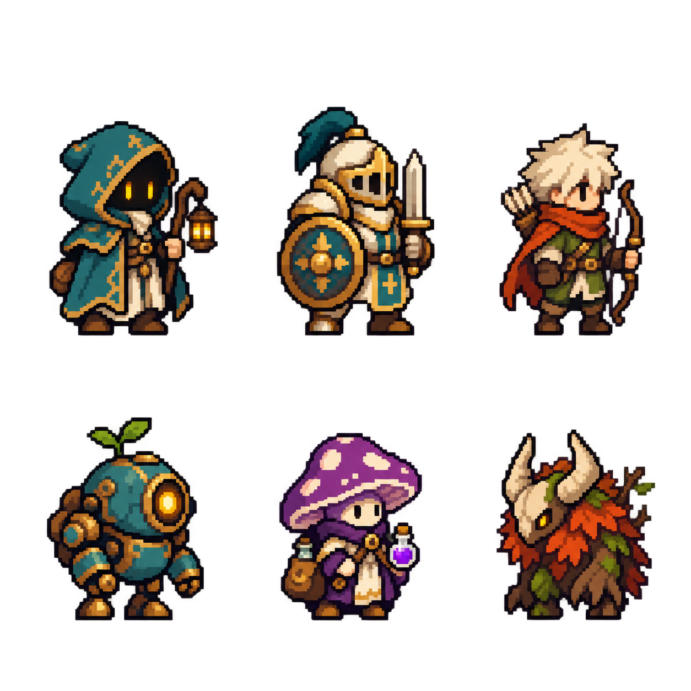

# 잔불 원정대 중세 판타지 게임 기획서

2026년 10월 18일 · 기획 초안 0.6 · 개발 가칭 Ember Expedition

> **후속 기획:** 월드맵에서 스테이지를 선택하고 별을 획득하는 [진행 구조 v0.7](stage-plan-v0.7/잔불원정대-월드맵-스테이지-기획.md)을 검토 중이다. 아래 6전투 원정 길이는 이전 초안의 값이며, 스테이지 단위 진행으로 바뀔 수 있다.

**무너진 왕국의 길목에서 기사·궁수·마법사·사제를 영입하고, 훈련과 특성 전승으로 팀을 성장시켜 보스를 돌파하는 가로형 도트 오토배틀러.** 핵심 경험은 동료를 누구에게 투자할지 선택하고, 완성된 조합이 전장에서 강하게 작동하는 모습을 보는 것이다.

**미술과 세계관의 기준은 사용자가 선택한 중세 판타지다.** 잔불·등불·원정의 분위기를 유지하고, 방패 기사·등불 사제·불꽃 마법사를 첫 구성으로 잡는다. 0.5 동양풍 초안을 대체하는 현재 기획이며, 상세 외형·능력·수치는 계속 검증한다. 첫 조합의 한 전투에는 훈련·전승·기사 진화와 성문 골렘이 구현됐고, 아래의 6전투 원정 전체는 후속 제작 범위다.

## 1 프로젝트 기준과 이번 설계의 범위

| 구분 | 기준 |
| --- | --- |
| 사용자 조건 | Android 우선, Galaxy Buddy2에서 테스트, 인앱결제 없음 |
| 상품 구성 | 광고가 있는 무료 앱과 광고 없는 별도 유료 앱 |
| 개발 도구 | Unity 6.3 LTS와 C# |
| 플레이 방향 | 가로 화면, 도트 그래픽, 전투 전 드래그 배치, 자동 전투 |
| 우선순위 | 동료 조합과 연쇄 효과, 배치와 보스 공략 |
| 채택한 테마 | 중세 판타지와 잔불을 옮기는 원정대 |
| 상세 규칙 제안 | 동료 훈련과 특성 전승, 역할이 달라지는 분기 진화 |
| 첫 제작 범위 | 6전투의 짧은 원정, 기본 동료 6종, 진화 가능 계열 3종, 보스 2종 |
| 후속 후보 | 세 번째 보스, 나머지 계열의 진화, 장비·골드 경제·영구 해금 |

0.4 비교안에서 검토한 출전·성장·전승의 선택을 구체화한다. 이전의 15전투·출전 5명·12계열은 장기 비교 기준으로 남기고, 첫 플레이 검증에는 아래의 작은 구성을 쓴다. 짧은 검증판을 출시 분량으로 간주하지 않는다.

## 2 중세 판타지 세계관과 미술 방향

### 잔불을 옮기는 원정대

왕국의 봉화가 꺼진 뒤 오래된 수호 장치와 성 밖의 괴물들이 길을 막았다. 원정대는 마지막 불씨를 등불에 담아 폐허가 된 마을과 요새를 잇는다. 길에서 만난 기사·사제·마법사·궁수는 각자의 이유로 합류하고, 다음 거점을 밝히기 위해 힘을 보탠다.

첫 원정의 목적은 폐성 입구의 성문 골렘을 넘고 숲길의 추적자를 물리쳐 다음 봉화대에 도착하는 것이다. 긴 설정 설명보다 배경의 꺼진 봉화와 승리 뒤 켜지는 등불로 목적을 전달한다. 제목은 잔불 원정대 / Ember Expedition을 개발 가칭으로 유지한다.

### 화면에서 바로 읽히는 역할

| 항목 | 미술 기준 |
| --- | --- |
| 전체 분위기 | 따뜻한 불빛이 남은 중세 판타지. 친근한 동료와 묵직한 적의 대비 |
| 기본 소재 | 판금·사슬 갑옷, 가죽 장비, 천 망토, 목재, 석조 성벽, 철제 등불 |
| 장소 | 무너진 성문, 황혼의 숲길, 버려진 예배당, 산길 봉화대 |
| 아군 색 | 기존 시안의 크림색·금색·청록색을 유지하고, 궁수의 적갈색과 직업별 강조색을 활용 |
| 위협 표시 | 적 공격 예고는 붉은 외곽선과 바닥 무늬. 아군 화염의 주황과 형태로 구분 |
| UI | 기존 시안의 어두운 청록색 패널과 금색 주요 버튼을 기반으로 구성. 질감은 정보 가독성을 해치지 않게 제한 |
| 공통 상징 | 작은 불씨 문양과 원정 장비. 모든 인물이 같은 옷을 입을 필요는 없음 |

방패 기사는 큰 방패와 낮은 자세, 등불 사제는 밝은 등불과 긴 옷, 불꽃 마법사는 짧은 지팡이와 불꽃 모양 장식으로 구분한다. 궁수는 활, 서리 마법사는 각진 수정, 서약 기수는 세로로 긴 깃발을 중심으로 실루엣을 잡는다. 외형을 작게 보아도 역할이 구분되는지가 장식의 양보다 우선한다.

방패 충격, 화살 궤적, 불덩이 폭발이 힘 있게 보이도록 무기와 공격 자세를 크게 읽히게 만든다. 진화하면 갑옷 색만 바꾸는 데서 끝내지 않고 방패 형태·무기·공격 궤적과 역할을 함께 바꾼다.

### 기존 도트 시안을 발전시키는 방향

**기준 시안은 처음 만든 기사·궁수가 있는 중세풍 캐릭터 시트다.** 사용자가 이 시안을 유지할 방향으로 선택했다. 작은 체형과 큰 머리·장비, 선명한 도트 덩어리, 크림색·금색·청록색의 조합을 유지하며 새 동료와 진화 형태를 확장한다. 방패 기사의 둥근 방패와 투구, 궁수의 적갈색 스카프와 가벼운 차림을 각 역할의 출발점으로 삼는다.

위 시트는 그림체 기준이다. 여섯 캐릭터를 모두 이번 출전 명단으로 확정하는 의미는 아니다. 기사와 궁수는 각 계열에 연결하고, 등불 캐릭터는 등불 사제의 색감과 소품에 참고한다. 불꽃 마법사·서리 마법사·서약 기수와 진화형은 같은 비율과 도트 밀도로 추가한다. 자동인형·버섯 캐릭터·숲 괴물의 콘텐츠 편입 여부는 후속 검토로 둔다.

전투용 시트에서는 캐릭터와 무기가 이웃 칸을 침범하지 않도록 분리하고 발 위치와 크기를 통일한다. 원화의 모든 장식을 작은 도트에 그대로 넣기보다 휴대폰 화면에서 읽히는 부분을 남긴다. 기존 디자인의 매력과 실제 전투 가독성을 함께 확인한다.

### 성장과 동료 이탈의 표현

동료를 훈련이나 전승에 사용하면 해당 개체는 원정 명단에서 빠진다. 이야기에서는 훈련을 돕거나 기술을 전수한 뒤 거점으로 돌아간 것으로 표현한다. 새로 영입한 같은 계열은 새 개체이며, 떠난 동료의 성장 상태가 복원되지는 않는다.

훈련은 진화 진행도를 올리고, 특성 전승은 다른 계열의 성질을 섞는다. 불씨는 세계관의 상징으로 사용하며 첫 검증판의 별도 소비 재화로 만들지 않는다. 중세풍 선택을 이유로 새로운 속성·진영·화폐 시스템을 추가하지 않는다.

## 3 한 판의 기본 흐름

**위협 확인 → 동료 영입 → 출전·훈련·전승 선택 → 진화 → 배치 → 자동 전투 → 결과와 다음 선택**을 반복한다.

첫 검증판은 아래 수치로 시작한다. 수치는 게임 감각을 확인하기 위한 초기값이다.

| 항목 | 첫 검증판 규칙 |
| --- | --- |
| 원정 길이 | 6전투, 3번째와 6번째가 보스 |
| 시간 목표 | 전투 20~45초, 준비 30~60초를 기준으로 총 6~10분부터 확인 |
| 시작 동료 | 방패 기사·등불 사제·불꽃 마법사 각 1명 |
| 출전 | 최대 4명, 최소 1명 |
| 대기 | 최대 4명. 영입 처리 중에만 임시 대기 2칸 허용 |
| 기본 영입 | 1~5전투 승리 후 후보 3명 중 2명 선택 |
| 중복 | 같은 계열의 보유·동시 출전 허용. 한 제안의 후보 3명은 서로 다른 계열 |
| 전투 뒤 회복 | 쓰러진 동료를 포함해 전원 HP 회복, 보호막·표식·화상·재사용 대기시간 초기화 |
| 전투 조작 | 일시정지와 1배·2배속. 전투 중 배치·수동 스킬은 없음 |
| 패배 | 원정당 재정비 1회. 편성과 배치를 바꾸고 같은 전투 재도전 |
| 재도전 제한 | 새 영입·추가 보상 없음. 같은 적과 전투 난수 조건 유지 |

대기 공간이 넘치면 출전·훈련·전승·떠나보내기 중 하나로 정리해야 다음 전투를 시작할 수 있다. 자동 삭제하지 않는다. 떠나보내기는 보상 없이 개체를 제거하며, 소모 대상과 손실을 확인한다.

전투 제한 시간은 우선 60초로 두고, 초과하면 패배 처리한다. 무한 회복으로 전투가 끝나지 않는 경우를 막는 장치다. 전투 시간 목표와 제한 시간은 구분한다.

### 랜덤과 선택의 균형

첫 영입의 세 후보에는 아직 없는 정찰 궁수·서리 마법사·서약 기수를 제시해 역할을 소개한다. 이후에는 6계열에서 무작위로 세 계열을 뽑고 두 명을 고른다. 희귀도와 개체별 랜덤 능력치는 첫 검증판에서 넣지 않는다.

이 구조는 출전 인원을 채운 뒤에도 영입한 동료를 훈련과 전승에 쓸 수 있게 한다. 특정 캐릭터를 반복 획득해야만 진화하는 조건은 두지 않는다. 출시 설계에서 검토할 단일 동료와 묶음 보상의 비교는, 이 기본 흐름을 확인한 뒤 진행한다.

## 4 동료를 쓰는 세 가지 방법

| 선택 | 결과 | 비용과 제한 |
| --- | --- | --- |
| 함께 출전 | 고유 행동과 본래 특성을 전투에 사용 | 출전 자리 1칸 |
| 동료 훈련 | 받는 동료의 진화 진행도 1 증가 | 주는 동료 1명 소모. 특성은 전달하지 않음 |
| 특성 전승 | 주는 동료의 본래 특성을 다른 동료에게 추가 | 주는 동료 1명 소모. 훈련 진행도는 증가하지 않음 |

한 번의 소비에서 훈련과 전승을 동시에 받지 않는다. 출전 중인 동료도 재료로 고를 수 있지만 원정에 최소 1명은 남아야 한다. 출전 자리의 손실은 확정 화면에 함께 표시한다.

### 동료 훈련과 진화

진화 가능한 기본 동료에게 다른 동료 2명을 훈련 재료로 주면 진행도가 2에 도달한다. 그때 두 분기 중 하나를 선택하고 진화한다. 재료의 계열과 진화 여부에 관계없이 1명당 진행도는 1이다. 동일 계열 보너스는 없다.

첫 검증판에서는 한 개체가 한 번만 진화한다. 이미 진화했거나 아직 진화 분기가 없는 계열에는 훈련 버튼을 비활성화한다. 진화가 준비되지 않은 동료에게 재료를 쓰도록 허용하지 않는다.

진화는 고유 행동·외형을 바꾸고, 해당 역할에 필요한 기본 수치도 올린다. 본래 특성과 전승받은 특성은 유지한다. 분기 선택은 준비 단계의 되돌리기에 포함한다. 선택 후 전투를 시작하면 해당 원정에서는 분기를 바꿀 수 없다. 선택 전에는 바뀌는 행동과 공격 범위를 비교할 수 있다.

### 특성 전승

모든 동료는 **본래 특성 1개와 전승 특성 최대 1개**를 가진다. 본래 특성은 고정이며, 전승할 수 있는 것은 주는 동료의 본래 특성뿐이다. 고유 행동·진화 분기·전승받았던 특성은 옮겨지지 않는다.

이미 전승 특성이 있으면 새 특성으로 교체할 수 있다. 기존 전승 특성은 사라지고 주는 동료도 소모된다. 같은 특성을 이미 가진 동료에게는 전승할 수 없다. 특성은 중첩 강화되지 않는다.

예를 들어 불꽃 마법사의 ‘불씨’를 방패 기사에게 전승하면 방패 기사의 평타가 화상을 남긴다. 방패 기사의 보호막이나 충격파까지 전부 화상을 남기지는 않는다. 이후 그 방패 기사를 정찰 궁수에게 전승 재료로 쓰면, 정찰 궁수가 받는 것은 방패 기사의 본래 특성인 ‘버팀’이다. 앞서 옮긴 ‘불씨’는 소멸한다.

### 조작 실수와 되돌리기

소비 화면에는 받는 동료, 떠나는 동료, 사라지는 성장·특성, 완료 결과를 나란히 표시한다. **준비 단계에서는 마지막 소비 작업부터 순서대로 되돌릴 수 있고, 전투 시작 시 확정한다.** 되돌리기는 동료·진행도·특성을 작업 전 상태로 함께 복구한다. 새로운 후보를 뽑는 기능은 아니며, 영입 후보를 바꾸지 않는다.

전장 드래그는 오직 위치 이동에 사용한다. 동료 위에 동료를 놓아도 소비하지 않는다.

## 5 첫 동료 6종

이름은 역할을 알아보기 위한 작업명이다. 아래 행동 주기와 비율은 초기 테스트값이다. 실제 전투에는 평타 공격력·HP·방어·사거리의 별도 균형 조정이 필요하다.

### 고유 행동과 전승 가능한 특성

| 계열 | 역할과 고유 행동 | 본래 특성과 전승 효과 | 외형의 중심 |
| --- | --- | --- | --- |
| 방패 기사 | 근접 방어. 전투 시작 시 자기 최대 HP의 25% 보호막을 6초간 얻음 | 버팀: HP가 처음 40% 이하가 될 때 자기 최대 HP의 20% 보호막을 4초간 얻음. 전투당 1회 | 기존 시안의 둥근 방패, 크림색·금색 갑옷과 청록 장식, 짧은 검 |
| 등불 사제 | 보호 지원. 5초마다 사거리 안에서 HP 비율이 가장 낮은 아군에게 시전자 최대 HP의 15% 보호막을 4초간 부여 | 등불의 축복: 자신에게 유효한 보호막이 있는 동안 평타 간격 15% 감소 | 철제 등불, 상아색 법의, 얼굴이 보이는 짧은 어깨 망토 |
| 불꽃 마법사 | 원거리 공격. 4초마다 작은 범위에 불덩이를 던져 직접 피해와 화상 부여 | 불씨: 자신의 평타가 화상 부여. 같은 대상에 2초당 1회 | 불씨가 든 짧은 지팡이, 주황 안감의 망토, 비대칭 장갑 |
| 정찰 궁수 | 원거리 집중. 4초마다 현재 표적에게 추적 화살을 쏴 직접 피해와 표식 4초 부여 | 추적: 표식이 있는 적에게 주는 직접 피해 15% 증가 | 기존 시안의 적갈색 스카프, 밝은 머리, 목제 활과 가벼운 가죽 장비 |
| 서리 마법사 | 중거리 제어. 5초마다 현재 표적 주변에 서리 파동을 보내 직접 피해와 이동 속도 30% 감소 3초 부여 | 해빙: 자신의 능력이 하나 이상의 적에게 둔화를 실제 적용하면 주변 부상 아군 1명을 자기 최대 HP의 5%만큼 회복. 4초 재사용 대기 | 각진 수정 지팡이, 짧고 넓은 청색 어깨 망토 |
| 서약 기수 | 보조 공격. 5초마다 가장 가까운 아군에게 4초간 연결. 연결 대상이 받는 직접 피해 20%를 자신에게 이전 | 서약: 6초마다 가장 가까운 다른 아군에게 시전자 최대 HP의 10% 보호막을 3초간 부여. 대상이 없으면 미발동 | 세로로 긴 원정 깃발, 사슬 갑옷, 짧은 보조 무기 |

특성이 붙었다고 항상 강해지는 것은 아니다. 기본 방패 기사는 둔화 능력이 없어 ‘해빙’을 받아도 발동시키지 못한다. 이런 조합에는 전승 확정 전에 ‘현재 행동으로 발동 불가’를 표시한다. 다음 진화에서 사용할 계획이면 선택 자체는 허용한다.

연결 피해는 다시 이전하거나 피격 계열 효과를 발동시키지 않는다. 연결 피해는 서약 기수의 보호막과 HP로 처리하지만, 그 보호막이 깨져도 반격은 발생하지 않는다. 서약 기수의 연결 거리가 끊기거나 어느 한쪽이 쓰러지면 연결도 끝난다.

### 첫 검증판의 진화 6형태

| 기본 계열 | 진화 A | 진화 B |
| --- | --- | --- |
| 방패 기사 | **반격 기사:** 자신의 보호막이 적의 직접 피해로 깨질 때 전방 부채꼴 충격파로 범위 안 적에게 직접 피해와 둔화 2초. 3초 재사용 대기 | **수호 기사:** 5초마다 가까운 아군 1명에게 자기 최대 HP의 15% 보호막을 4초간 부여. 보호한 아군 쪽을 향한 방패 실루엣으로 변화 |
| 정찰 궁수 | **연쇄 궁수:** 표식 적 처치 시 가까운 미표식 적에게 표식을 옮기고 그 적에게 추가 화살 1발. 1초 재사용 대기 | **관통 궁수:** 고유 추적 화살이 현재 표적 뒤의 적 1명까지 관통하고 두 대상에 표식. 주 대상이 단독이면 주 대상 피해 30% 증가 |
| 불꽃 마법사 | **확산 마법사:** 자신의 공격 사거리 안에서 화상 적이 죽으면 가까운 적 최대 2명에게 같은 중첩 수의 화상 전파. 1초 재사용 대기 | **폭발 마법사:** 고유 불덩이가 이미 화상인 적의 화상을 제거하고 남은 지속 피해 총량만큼 즉시 추가 피해. 기존 화상이 없으면 화상 부여 |

방패 기사의 시작 보호막, 정찰 궁수의 추적 화살, 불꽃 마법사의 평타 화상처럼 기본 행동은 유지하고 표에 적은 부분을 변경·추가한다. 고유 행동 전체를 전승하는 규칙은 없다.

등불 사제·서리 마법사·서약 기수의 진화는 첫 검증 범위에서 제외한다. 따라서 필요한 전투 형태는 **기본 6개와 진화 6개, 총 12개**다. 지원 계열이 성장 선택에서 소외되면 다음 확장 순서를 지원 진화로 잡는다.

## 6 연쇄 효과의 공통 규칙

조합을 설명한 문구와 실제 결과가 같아야 한다. 다음 규칙을 공통으로 적용한다.

| 효과 | 초기 규칙 |
| --- | --- |
| 보호막 | 대상당 유효 보호막 1개. 새 값이 남은 값보다 크면 수치·지속시간 교체, 같거나 작으면 미적용. 합산하지 않음 |
| 보호막 파괴 | 적의 직접 피해가 남은 보호막을 0으로 만든 사건. 시간 만료·교체·전투 종료·연결 피해는 제외 |
| 파괴 반격 | 피해와 사망 판정 후 처리. 보호막 주인이 쓰러졌으면 반격 없음. 과잉 피해는 HP에 적용 |
| 직접 피해 | 평타와 충격파·화살 등 공격 능력의 명중 피해. 화상과 연결 피해는 제외 |
| 화상 | 대상당 최대 3중첩, 3초, 초당 1회. 마지막으로 정상 적용한 시전자의 공격력 10% × 중첩 수가 매 틱 피해 |
| 화상 갱신 | 정상 적용 시 중첩 1 추가, 최대 3. 지속시간과 시전자 정보 갱신. 수치는 부여 순간 공격력으로 고정 |
| 화상 확산 | 전파된 화상은 재전파하지 않음. 정상 화상 적용이 다시 들어오면 일반 화상으로 갱신되어 다음 처치에서 전파 가능 |
| 화상 확산 주체 | 사망한 적이 확산 마법사의 공격 사거리 안에 있어야 함. 화상을 건 동료나 마지막 일격의 주인은 제한하지 않음 |
| 표식 | 적별 표식 1개, 아군 전체가 활용. 다시 적용하면 지속시간만 갱신. 표식끼리 피해 보너스를 더하지 않음 |
| 둔화 | 가장 강한 이동 속도 감소만 적용. 공격 속도는 변화 없음. 보스는 둔화량을 절반만 받음 |
| 추가 공격 | 평타 명중으로 취급하지 않음. ‘불씨’ 같은 평타 전용 특성을 발동시키지 않음 |
| 처치 | 한 적의 사망 사건은 1회 처리. 자격이 있는 아군 각자의 처치 효과는 각자 재사용 대기시간에 따라 처리 |

한 사건에서 생긴 추가 화살·확산 등은 다음 전투 처리 순서에 넣는다. 이미 죽은 적에게 피해를 반복하거나, 같은 사망을 다시 처리하지 않는다. 폭발 마법사의 화상 소모 피해는 별도 화상 적용이나 화상 확산을 발생시키지 않는다.

확산이 큰 규모로 이어지는 장면은 허용하되, 전파된 화상만으로 끝없이 퍼지는 구조는 막는다. 기본 공격·스킬이 다시 연결되어야 다음 연쇄가 이어진다.

## 7 대표 조합 세 가지

### 보호막 반격

**등불 사제 보호막 → 반격 기사가 전방에서 피격 → 보호막 파괴 충격파 → 다시 보호막을 받아 다음 반격.** 서리 마법사의 ‘해빙’을 반격 기사에 전승하면 충격파의 둔화가 근처 아군 회복으로 이어진다.

- 기본 구성: 반격 기사·등불 사제·불꽃 마법사. 네 번째 자리는 보스 대응용으로 사용한다.
- 대체 구성: 등불 사제 대신 서약 기수의 주기 보호막을 활용할 수 있다. 보호 빈도와 범위가 달라진다.
- 배치: 방패 기사는 적 무리와 먼저 만나고, 보호 지원은 범위 안에서 뒤로 물린다.
- 성장 선택: 서리 마법사를 남기면 원거리 제어가 생기고, 전승하면 방패 기사의 반격에 회복이 붙는다.
- 약점: 적이 천천히 강하게 때리거나 후방만 공격하면 반격 빈도가 낮다. 과도하게 큰 보호막도 파괴를 늦춘다.
- 화면 보상: 보호막에 균열 → 파편 → 낮고 넓은 충격파 → 적들의 동시 피격. 회복은 작은 녹색 빛으로 분리한다.

### 표식 집중과 이어쏘기

**추적 화살 표식 → 원거리 동료들이 표식 적 집중 → 처치 → 연쇄 궁수가 다음 적으로 표식과 화살을 연결.** 공격 동료에게 ‘추적’을 전승하면 집중 피해가 높아진다.

- 기본 구성: 연쇄 궁수·불꽃 마법사·방패 기사. 등불 사제나 서약 기수를 네 번째로 선택한다.
- 대체 구성: 기본 정찰 궁수와 ‘추적’을 가진 다른 공격수만으로도 집중 공격이 성립한다. 이어쏘기는 연쇄를 강화한다.
- 배치: 집중시킬 적이 두 공격수의 사거리 안에 들어오도록 같은 쪽에 배치한다.
- 성장 선택: 두 번째 정찰 궁수를 출전시켜 표식을 늘릴지, 다른 공격수에게 ‘추적’을 줄지 판단한다.
- 약점: 잡몹이 없는 단독 보스에서는 처치 연쇄가 적다. 관통 궁수 분기는 이 상황을 대비하는 대안이다.
- 화면 보상: 표식이 닿은 적을 짧게 강조하고, 처치 직후 은빛 궤적이 다음 적으로 이어진다.

### 화상 축적과 번짐

**불꽃 마법사가 화상을 쌓음 → 서리 마법사가 접근을 늦춤 → 적 처치 → 확산 마법사의 화상이 주변으로 전파.** 다른 공격수에게 ‘불씨’를 전승하면 화상 공급을 늘리고, 확산 마법사는 그 적이 죽었을 때도 확산을 일으킬 수 있다.

- 기본 구성: 확산 마법사·서리 마법사·방패 기사. 네 번째 자리는 등불 사제 또는 다른 공격수다.
- 대체 구성: 기본 불꽃 마법사와 보호 지원으로 지속 피해를 유지할 수 있다. 폭발 마법사는 확산 대신 단일 적의 화상을 한꺼번에 터뜨린다.
- 배치: 탱커가 적을 붙잡는 지점에 불덩이 범위가 닿게 한다. 서리 마법사는 후방에서 접근로를 늦춘다.
- 성장 선택: 새로운 불꽃 마법사를 남기면 화상 공급이 늘고, 훈련에 쓰면 기존 불꽃 마법사의 진화가 빨라진다.
- 약점: 적이 흩어져 있으면 확산 효율이 낮다. 확산 마법사와 너무 먼 곳에서 죽은 적은 확산하지 않는다.
- 화면 보상: 작은 불씨가 모인 뒤 처치 순간 낮은 불꽃이 이웃 적으로 튄다. 보스 예고 영역을 불길로 덮지 않는다.

세 조합은 완성된 정답 덱이 아니라 선택의 출발점이다. 네 번째 자리에 다른 역할을 넣거나, 한 계열의 특성을 다른 역할에 옮겨 약점을 메우게 한다. 같은 계열 네 명이 모든 보스에서 가장 강하다면 출전 금지부터 추가하기보다 행동·사거리·중복 효과를 먼저 조정한다.

## 8 배치가 전투 결과를 바꾸는 규칙

전장은 왼쪽 아군 준비 구역과 오른쪽 적 구역으로 나눈다. 준비 구역 안에서는 자유롭게 드래그하고, 겹친 위치는 가까운 빈자리로 보정한다. 전투 시작 전에는 최초 이동 방향·사거리·보호 대상·보스의 첫 특수 공격 대상을 확인할 수 있다.

| 역할 | 이동과 표적 선택 |
| --- | --- |
| 근접 방어 | 가장 가까운 적에게 접근해 교전. 현재 표적이 살아 있으면 유지 |
| 원거리 공격 | 사거리 안에서 공격. 현재 표적이 죽거나 사거리 밖으로 나가면 다시 선택. 새 선택에서는 사거리 안 표식 적을 우선 |
| 보호 지원 | 가장 가까운 아군 근접 방어를 따라감. 방어 역할이 없으면 가장 가까운 다른 아군을 따라감. 적에게 혼자 접근하지 않음 |
| 중거리 제어 | 적이 사거리에 들어올 때까지 접근하고 멈춤. 적을 밀어내거나 자동 도주하지 않음 |

동일 우선순위에서는 거리, 동률이면 전투 시작 때 정한 개체 순서로 결정한다. 표식이 생길 때마다 모든 유닛이 표적을 바꾸지는 않는다. 경로가 잠깐 막혔다고 표적을 계속 왕복하는 동작도 피한다.

지원의 보호 대상은 스킬 발동 시점의 범위와 HP로 정한다. 서약 기수의 연결 대상은 스킬 발동 시점에 가장 가까운 다른 아군이며 연결 중에는 바꾸지 않는다. 준비 화면의 선은 첫 대상 예상이고, 전투 중 위치 변화에 따라 이후 대상은 달라질 수 있다.

이 규칙에서 배치는 첫 교전, 범위 피해의 동시 피격, 보호 범위, 첫 연결 대상에 영향을 준다. ‘뒤에 놓았으니 끝까지 뒤를 지킨다’고 약속하지 않는다. 특정 위치 고정이나 호위 명령은 필요성이 확인되면 별도 규칙으로 추가한다.

## 9 보스와 두 가지 이상의 공략

보스는 전투 중 손으로 피하는 조작을 요구하지 않는다. 예고는 준비 단계의 판단과 전투 결과 이해를 돕는다. 보스에게 가는 준비 화면에서는 위협 설명·첫 대상·공격 범위를 함께 보여준다.

### 첫 보스인 성문 골렘

무너진 성문의 철제 격자와 돌벽이 몸을 이룬 옛 수호 장치. 넓은 어깨와 무거운 팔을 내려쳐 전방을 공격한다. 기존 골렘 시안에서 역할에 맞는 형태를 검토하고 중세 석조 성문의 재료와 장비로 다듬는다.

- 기본 공격: 가장 가까운 아군에게 느리고 강한 근접 공격.
- 특수 공격: 전투 4초부터 7초마다, 발동 시작 시 가장 가까운 아군 방향을 고정하고 0.8초 뒤 전방 부채꼴 충격. 예고 중 방향은 추적하지 않는다.
- 광역 피해는 같은 부채꼴 안의 아군에게 적용한다. 넉백은 첫 검증판에서 제외한다.
- 대응 A: 방패 기사를 다른 아군과 떨어진 위쪽에 놓아 첫 충격 방향을 유도하고, 공격수는 아래쪽에서 공격한다.
- 대응 B: 등불 사제·서약 기수로 보호를 집중하고 한쪽에 모여 버틴다. 공격수까지 맞는 위험과 보호 효율을 교환한다.
- 조합 보상: 보호막 파괴 반격이 잘 보인다. 화상과 표식 집중으로 빠르게 처치하는 방법도 가능하게 조정한다.
- 패배 설명: ‘첫 충격에 아군 3명이 함께 맞음’, ‘등불 사제의 보호 범위 밖에서 방패 기사가 쓰러짐’처럼 관찰 사건을 보여준다.

첫 충격 방향을 유도한 뒤에도 이동으로 대형이 무너질 수 있다. 실제 첫 충격까지 배치 의도가 유지되는지 테스트하고, 유지되지 않으면 공격 시점이나 이동 규칙을 수정한다.

### 두 번째 보스인 황혼 추적자

등에 부러진 철창 조각이 박힌 네 발의 숲 괴물. 긴 앞발로 후방을 덮치며 전방 수비에만 투자한 팀을 시험한다. 모습과 이름은 작업안이다.

- 전투 시작 시 보스에게서 가장 먼 아군을 ‘추격 대상’으로 지정한다. 준비 화면에서 그 대상에 표시한다.
- 전투 5초부터 8초마다 추격 대상을 향해 도약 공격. 공격 뒤 원래 교전 지점으로 돌아간다.
- 대상이 쓰러지면 다음 특수 공격 준비 때 가장 먼 생존 아군을 새 대상으로 지정한다. 그 전에는 임의 변경하지 않는다.
- 대응 A: 방패 기사를 가장 뒤에 놓아 추격을 받고, 다른 동료는 앞쪽에서 보스를 공격한다. 전방 생존을 별도로 보완해야 한다.
- 대응 B: 후방 공격수에게 ‘버팀’을 전승하고 등불 사제의 보호를 받을 수 있는 간격을 만든다.
- 대응 C: 서약 기수를 추격 대상 곁에 놓아 연결 피해를 분담한다. 서약 기수 자신의 생존도 필요하다.
- 첫 도약은 기본 상태의 건강한 공격수를 한 번에 쓰러뜨리지 않는 피해량으로 시작한다. 두 번째 도약 전 대응과 처치 속도에서 차이가 나게 한다.

뒷줄 공격을 전부 무효화하는 특정 희귀 유닛을 요구하지 않는다. 시작 동료와 일반 영입만으로 최소 두 대응을 성립시킨다.

### 확장 후보인 망령 지휘관

부서진 갑옷과 전투 깃발을 가진 망령이 쓰러진 병사를 불러내는 증원형 보스. 첫 검증판의 6전투에는 포함하지 않는다.

보스는 정해진 주기로 망령 병사을 부른다. 표식 처치 연쇄·화상 확산으로 병사을 정리하는 방법과, 내구성으로 버티며 단일 화력을 보스에 집중하는 방법을 비교한다. 보스를 쓰러뜨려도 남은 병사까지 정리해야 승리한다. 무한 증원으로 지연되지 않도록 증원 횟수를 제한한다.

세 번째 보스는 첫 두 보스에서 기본 배치가 작동한 뒤 제작한다. 등장 적 수를 늘리는 만큼 Buddy2에서 프레임과 효과 가독성도 함께 확인한다.

## 10 첫 원정의 선택과 자원 검산

### 전투별 경험

| 전투 | 전투의 역할 | 승리 후 선택 |
| --- | --- | --- |
| 1 숲길의 잔영 | 시작 3명으로 기본 공격과 보호 확인 | 정찰 궁수·서리 마법사·서약 기수 중 2명 영입. 출전 4명 구성 |
| 2 성벽의 잔해병 | 여러 적을 상대로 범위와 간격 확인 | 랜덤 3명 중 2명 영입. 첫 진화에 쓸 수 있는 개체 수 확보 |
| 3 성문 골렘 | 첫 진화와 배치의 결과 확인 | 2명 영입, 다음 보스 공개. 전승 설명과 재편 기회 |
| 4 흩어진 불빛 | 완성된 조합의 강함을 즐기는 일반전 | 2명 영입. 두 번째 진화 또는 전승 투자 |
| 5 숲길 추격대 | 뒤를 위협하는 적으로 다음 보스 예행연습 | 마지막 2명 영입. 최종 편성·후방 보호 준비 |
| 6 황혼 추적자 | 보호·화력·배치를 함께 확인 | 원정 결과. 추가 동료 지급 없이 종료 |

보스 직전에 새 규칙을 갑자기 제시하지 않는다. 첫 보스의 부채꼴은 2전투에서 작은 적의 공격으로 소개하고, 후방 위협은 5전투에서 미리 경험하게 한다. 첫 보스 설명은 2전투 준비부터 열어 두어 훈련 전에 읽을 수 있게 한다.

### 훈련과 전승이 실제로 가능한가

출발 3명에 영입 10명을 더하면 한 원정의 총 공급은 **13명**이다. 이 중 서로 다른 동료 2명을 진화시키는 데 재료 4명, 특성 전승 2회에 재료 2명을 쓰면 **7명**이 남는다. 출전 4명과 대기 3명으로 운영할 수 있다.

| 시점 | 이번 영입 | 예시 소비 | 남은 개체 |
| --- | --- | --- | --- |
| 출발 | 3명 | 없음 | 3명 |
| 1전투 뒤 | 2명 | 없음 | 5명 |
| 2전투 뒤 | 2명 | 훈련 2명으로 첫 진화 | 5명 |
| 3전투 뒤 | 2명 | 전승 1명 | 6명 |
| 4전투 뒤 | 2명 | 훈련 2명으로 두 번째 진화 | 6명 |
| 5전투 뒤 | 2명 | 전승 1명 | 7명 |

이는 가능한 투자 예시이며 강제 경로가 아니다. 진화 가능한 서로 다른 두 개체를 남겨 두어야 하고, 원하는 특성 재료의 출현까지 보장하지는 않는다. 특정 진화 계열이나 특성이 나오지 않아도 시작 방패 기사·불꽃 마법사와 남은 지원을 이용해 진행할 수 있어야 한다.

첫 검증에서는 골드·상점·골드를 쓰는 재선택을 넣지 않고 기본 공급을 고정한다. 0.4에서 제안한 단일 골드 경제는 후속 단계로 옮긴다. 여기서 비교할 것은 같은 13명을 출전·훈련·전승에 나누는 선택이다. 선택의 재미가 확인되면 골드로 추가 영입과 다른 성장을 경쟁시키는 구조를 붙인다.

## 11 가로 화면 UI와 타격감

### 준비 화면

화면 위에는 전투 번호·다음 위협·설정을 둔다. 중앙은 드래그 가능한 전장, 아래는 대기 동료와 영입 결과, 오른쪽은 선택한 동료의 상세 정보와 훈련·전승·진화 버튼이다. 전투 시작 버튼은 하단 오른쪽에 고정한다.

상세 정보에는 먼저 ‘무엇을 하는가’를 한 문장으로 보여준다. 피해 계수와 재사용 대기시간은 펼쳐 본다. 한 번 탭하면 동료 선택, 전장 안에서 끌면 배치, 별도 버튼을 누르면 성장 화면으로 들어간다. 작은 아이콘의 길게 누르기를 필수 조작으로 삼지 않는다.

### 성장 화면

받는 동료를 왼쪽, 재료를 오른쪽, 결과를 가운데에 둔다. 훈련은 진화 진행도와 다음 분기, 전승은 바뀔 특성을 보여준다. ‘동료 1명 떠남’과 기존 성장 손실을 확정 버튼 위에 표시한다.

진화 선택에서는 두 분기의 짧은 공격 예시와 역할 설명을 비교한다. 궁극적으로는 작은 전투 미리보기를 제공하되 첫 구현에서는 공격 범위와 행동 전후 설명으로 시작한다.

### 전투 화면

전투 시작 시 성장·영입 패널을 접고 전장을 넓힌다. 일시정지·배속·음량은 접근하기 쉬운 위치에 남긴다. 표식, 보호막, 화상은 색과 함께 서로 다른 모양으로 구분한다. 연결선은 실제 연결이 존재하는 동안만 보인다.

| 사건 | 시각 표현 | 소리와 강도 |
| --- | --- | --- |
| 평타 | 준비 자세, 짧은 궤적, 맞은 적의 피격 플래시 | 짧은 재질별 타격음 |
| 보호막 파괴 | 균열 후 파편, 이어지는 충격파 | 단단한 파열음 뒤 낮은 충격음 |
| 표식 연쇄 | 대상 위 표식과 다음 적으로 가는 화살 | 짧은 연속음을 사용하되 동시 발음 수 제한 |
| 화상 확산 | 낮은 높이의 불씨 이동, 새 대상 점화 | 큰 폭발음을 매번 반복하지 않고 작은 점화음 사용 |
| 진화 | 실루엣·무기 변화, 새 행동의 짧은 시연 | 한 번의 뚜렷한 전환음 |
| 보스 공격 | 땅의 방향·범위 예고 후 큰 명중 | 일반 공격보다 낮고 큰 충격. 중요 사건만 짧은 화면 반응 |

도트 크기는 동료 기본 48×48 작업 격자, 진화 최대 64×64를 출발점으로 비교한다. 그림 전체 크기보다 화면에서 보이는 실루엣과 무기 궤적을 기준으로 결정한다. 작은 옷무늬를 줄이고 팔·무기·등짐의 움직임에 제작 시간을 쓴다.

충격 연출로 전투 시간을 잠깐 멈추게 한다면 시뮬레이션과 효과 시간도 함께 멈춘다. 한 명만 멈추고 다른 적의 피해가 계속 들어가는 식으로 전투 결과가 바뀌지 않게 한다. 화면 흔들기와 플래시 강도는 낮추거나 끌 수 있게 한다.

## 12 아트 제작과 고유성 관리

동료와 보스는 기존에 만든 시안과 역할 설명을 함께 보며 발전시킨다. Slotbound나 Pokémon의 캐릭터 외형·이름·스프라이트·애니메이션을 게임 자산으로 가져오지 않는다. 현재 테스트 앱의 기사·궁수도 활용 가능한 시안이지만, 최종 디자인은 애니메이션과 유사성 검토를 거쳐 선정한다.

등불 캐릭터는 기존 제작 기록에서 어두운 후드와 빛나는 눈의 조합을 유사성 검토 대상으로 기록했다. 청록색과 등불의 분위기를 살리면서 얼굴 표현·옷의 형태·문양을 조정한다. 다른 직업도 이름과 장비 문양을 함께 검토한다. 그림체 유지와 개별 디자인의 권리 검토는 함께 진행한다.

각 캐릭터는 정면보다 실제 전투에서 쓰는 옆 또는 비스듬한 시점부터 만든다. 기본 자세, 이동, 공격 준비, 명중, 피격, 쓰러짐을 확인하고 진화 외형으로 확장한다. 머리 장식만 바뀌는 진화보다 무기의 기능과 공격 자세가 달라지는 진화를 우선한다.

캐릭터별 제작 기록에는 역할, 실루엣 초안, 색, 사용한 참고 소재, 생성·수정 이력을 남긴다. 이름과 디자인의 유사성 검토를 거쳐 출시 후보를 정한다. 이 문서의 새 이름과 소재도 최종 권리 확인을 마친 자산으로 보지 않는다.

효과음은 기존 시제품처럼 직접 합성한 소리부터 만들 수 있다. 금속·현·목재 등의 음색을 흉내 내더라도 짧은 게임 효과음의 명료함을 우선한다. 음악과 외부 음원을 쓰게 되면 출처와 사용 조건을 별도로 기록한다.

## 13 제작 순서와 통과 기준

### 단계별 제작

| 단계 | 만드는 것 | 다음 단계로 넘어갈 기준 |
| --- | --- | --- |
| 첫 조합 | 시작 3계열, 방패 기사 2분기, 훈련·전승, 성문 골렘 | 같은 팀의 배치 변경으로 피격 결과가 달라지고, 반격 조합을 눈으로 알아볼 수 있음 |
| 짧은 원정 | 기본 6계열, 총 6진화 형태, 6전투, 영입, 보스 2종, 저장·복구 | 공급 13명으로 여러 투자 경로가 가능하고, 두 보스에 복수 대응이 성립 |
| 재미와 성능 조정 | 효과·음향·패배 정보·전투 시간, Buddy2 최적화 | 반복해도 선택이 기계적으로 고정되지 않고 실제 기기에서 조작·전투가 읽힘 |
| 확장 판단 | 세 번째 보스, 지원 진화, 골드·장비·해금 | 기존 조합의 빈틈과 플레이 피드백을 근거로 추가 범위 결정 |

첫 조합 단계의 등불 사제 ‘등불의 축복’이나 방패 기사 ‘버팀’은 다른 동료에게 전승해 차이를 확인할 수 있다. 표식·확산 조합은 짧은 원정 단계에서 함께 검증한다. 목표 품질은 최종적으로 세 조합의 연출과 공략을 모두 갖추는 것이다.

첫 조합 테스트에는 출전용 3명과 동일한 3계열의 대기 동료 각 1명, 총 6명을 고정 제공한다. 대기 2명으로 기사를 진화시키고 남은 대기 1명으로 특성을 전승하면 출전 3명이 남는다. 예를 들어 대기 기사와 마법사를 훈련에 쓰고 대기 사제의 ‘등불의 축복’을 반격 기사에게 전승한다. 초기화로 다른 분기와 전승을 비교한다. 이 고정 구성은 조합 테스트용이며, 짧은 원정의 13명 공급 규칙과 구분한다.

### 플레이 검증 질문

1. 첫 원정에서 유저가 설명을 다시 읽지 않고 훈련과 전승의 차이를 말할 수 있는가?
2. 첫 보스 전에 진화가 가능하다는 사실을 알아차리고, 진화 이후 행동 변화를 볼 수 있는가?
3. 같은 동료를 남기는 선택과 재료로 쓰는 선택이 각각 유리한 상황이 있는가?
4. 같은 팀을 재배치했을 때 성문 골렘의 첫 충격 동시 피격 수가 실제로 줄어드는가?
5. 황혼 추적자를 후방 방어 배치와 후방 공격수 보호 두 방법으로 이길 수 있는가?
6. 조합이 완성된 뒤 4전투에서 강해진 느낌을 충분히 받는가?
7. 패배 후 어떤 특성·배치·분기를 바꿀지 한 가지 이상 떠올릴 수 있는가?

### 기기 검증

Buddy2에서 안정적인 30FPS를 최소 목표로 두고, 여유가 있으면 60FPS 선택을 제공한다. 이는 아직 측정으로 달성한 성능이 아니다. 원정 3회를 연속 실행하며 프레임 시간·발열·터치 실수·배터리 변화와 전투 중 효과 가독성을 기록한다.

아군 4명과 동시 적 최대 8명을 첫 부하 범위로 잡는다. 피해 숫자·파편·음향의 동시 수를 제한해도 실제 피해 계산과 특성 발동은 생략하지 않는다. 후반 증원 보스가 이 범위를 넘으면 별도 부하 검증이 필요하다.

준비 완료, 소비·영입 확정, 전투 시작, 전투 종료 시 저장한다. 전투 중 앱을 종료하면 해당 전투의 시작 상태와 같은 난수로 다시 시작한다. 완료한 보상은 중복 지급하지 않고, 확정된 영입 후보는 앱을 다시 켜도 바뀌지 않는다. 되돌리기를 제공하는 준비 단계의 작업 기록도 복구한다.

## 14 수익 구조와 이번에 보류하는 기능

사용자 조건은 무료 광고판과 별도 유료 무광고판, 인앱결제 없음이다. 두 버전의 전투 규칙과 콘텐츠는 같게 두는 것을 권한다. 광고 노출은 원정 종료 뒤로 제한하고, 광고를 봐야 영입·재도전·강화가 가능한 구조는 사용하지 않는 안이다. 광고 빈도와 가격은 아직 정하지 않는다.

첫 짧은 원정에는 광고 SDK를 붙이지 않는다. 종료 결과와 저장을 먼저 안정화한 뒤 무료판에 광고를 연결한다. 무료판에서 유료판으로 옮길 때 진행 기록을 어떻게 이전할지도 출시 전에 정한다.

이번 범위에서 보류하는 항목은 다음과 같다.

- 특정 A와 B를 합쳐 새 종족 C를 만드는 고정 합성식.
- 모든 계열의 다단계 진화, 개체별 랜덤 옵션, 희귀도.
- 장비와 팀 전술, 진영 인원수 보너스를 한꺼번에 추가하는 것.
- 영구 능력치 누적, 장기 과금 재화, 온라인 랭킹과 멀티플레이.
- 기존안의 15전투·12계열을 바로 제작 목표로 확정하는 것.

이 기능들은 조합을 늘릴 수 있지만 설명과 제작량도 늘린다. 우선 훈련·전승·진화·배치만으로 다른 승리 방식이 나오는지 확인한다.

## 15 현재 결정과 다음 검토

**중세 판타지는 채택한 방향이다.** 캐릭터는 기존 도트 시안의 장점을 살려 이름·실루엣·색·장비를 다듬고, 훈련 비용과 전투 수치는 첫 조합 테스트로 확인한다. 제목과 출시 이름은 아직 가칭이다.

| 항목 | 현재 기준 |
| --- | --- |
| 미술과 세계관 | 중세 판타지. 동양풍·무협 초안은 이전 검토 이력으로 보관 |
| 기본 그림체 | 처음 만든 기사·궁수 중세풍 도트 시안의 비율·색감·도트 표현 유지 |
| 첫 출전 구성 | 방패 기사·등불 사제·불꽃 마법사 |
| 첫 진화 | 반격 기사와 수호 기사 |
| 핵심 선택 | 출전 유지 / 다른 동료의 진화 지원 / 본래 특성 전승 |
| 짧은 원정 | 기본 6계열·진화 6형태·출전 최대 4명·6전투·보스 2종을 검증안으로 사용 |
| 수익 조건 | 광고 무료판과 별도 유료 무광고판, 인앱결제 없음 |
| 이후 결정 | 역할별 최종 외형, 실제 공격력·HP·사거리, 전투 길이와 성장 비용 |

Slotbound에서 참고하는 가치는 획득한 동료의 여러 용도, 큰 성장 순간, 전투에서 드러나는 조합, 보스를 앞둔 판단이다. 이 문서의 동료·특성·진화·보스 패턴은 우리 게임의 신규 설계이며 원작 규칙을 설명하는 내용이 아니다.

### 이전 문서와의 관계

- [0.4 Slotbound 비교와 기획 검토](slotbound-comparison-v0.4.md): 참고작 분석과 조합 중심 방향의 근거.
- [0.5 동양풍 초안](ember-expedition-design-v0.5.md): 채택하지 않은 테마의 검토 이력. 현재 제작 기준은 이 0.6 문서다.
- [전투 연출 검토](combat-feel-review-v0.1.md): 이전 공개 영상 관찰과 타격감 방향.
- [Unity 구현과 기기 검증 범위](../unity/README.md): 기존 시제품의 실제 완료 범위.

현재 구현은 [첫 조합 전투](../unity/FIRST-SLICE.md)까지다. 중단한 무협 캐릭터 생성 이미지는 게임에 적용하지 않았다. 기존 중세 도트 시트의 기사와 등불 캐릭터를 사용하며, 불꽃 마법사·성문 골렘에는 시트의 다른 캐릭터를 임시로 표시한다. 첫 전투에서 훈련·특성 전승·기사 진화·성문 골렘을 확인했고, 영입·연속 원정·다른 동료 진화와 보스는 다음 제작 대상이다.

### 노션에 옮기기

같은 이름의 Markdown 파일이 편집용 원문이고 HTML은 읽기용이다. 노션의 Markdown 가져오기로 원문을 옮겨 제목·표·목록을 편집할 수 있다. 프로젝트 내부 상대 링크와 이미지가 자동으로 옮겨지지 않으면 위 기준 시트 PNG와 필요한 참고 문서를 별도로 첨부한다. 실제 구현 후에는 각 제작 단계의 검증 결과와 변경한 수치를 기록한다.
