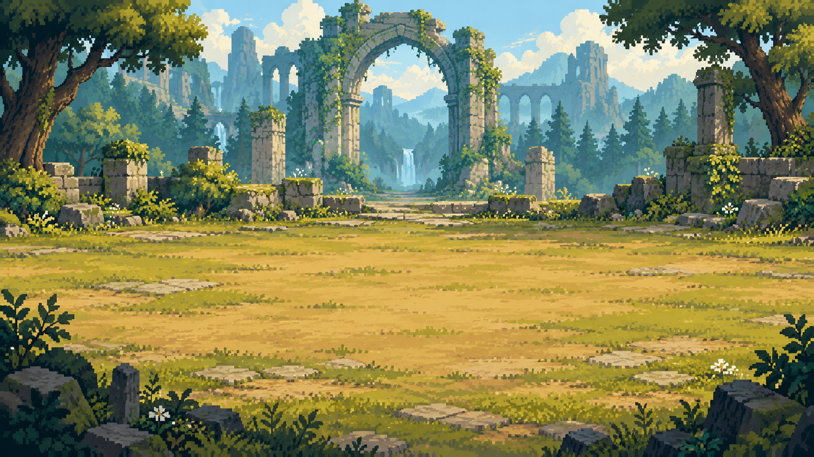
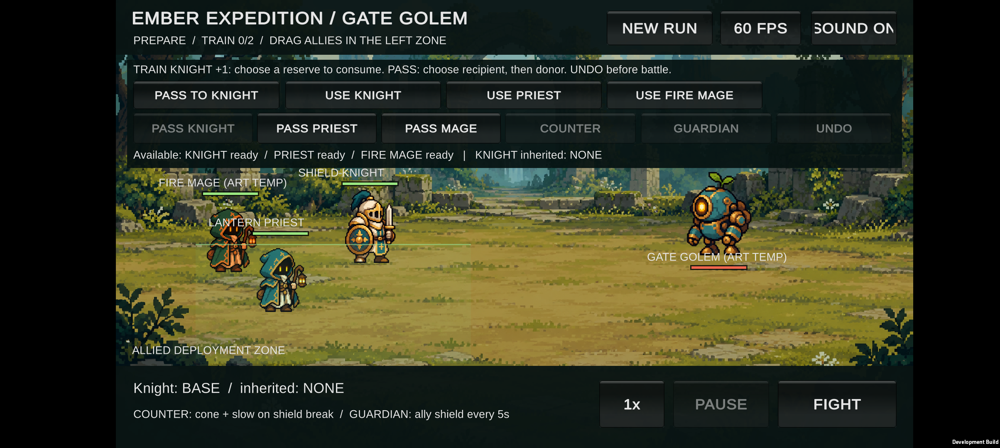

# 잔불 원정대: 월드맵과 스테이지 진행 기획

2026년 10월 18일 · Notion 정리용 v0.7 · **기획 제안, 미구현**

**한 줄 설명:** 중세 판타지 월드맵에서 스테이지를 고르고, 짧은 원정 동안 무작위 동료를 영입해 조합과 배치를 완성한 뒤, 정예 또는 보스를 쓰러뜨려 점수와 별을 얻는다. 클리어 후에는 월드맵으로 돌아가 다음 길을 고르거나 별을 다시 노린다.

> 이 문서는 기존 [중세 판타지 기획 v0.6](../ember-expedition-design-v0.6.md)의 **진행 구조를 재검토하는 초안**이다. v0.6의 ‘6전투가 한 원정’이라는 수치는 확정 사항이 아니다. 캐릭터 조합·드래그 배치·자동 전투·도트 그래픽이라는 핵심은 유지한다.

## 1. 원하는 플레이 경험

- **목적지가 보인다.** 다음 전투가 곧바로 시작되는 대신, 지도를 보며 다음 스테이지를 선택한다.
- **장소가 바뀐다.** 숲길, 무너진 초소, 폐성의 문처럼 세계관과 적의 특징이 화면에 반영된다.
- **한 스테이지 안에서 조합이 자란다.** 전투 사이 무작위 동료 영입, 훈련, 특성 전승, 진화 중 무엇을 할지 고른다.
- **같은 장소도 다시 도전할 이유가 있다.** 첫 클리어는 다음 길을 열고, 높은 점수는 더 많은 별을 준다.
- **나중에 지역을 늘리기 쉽다.** 지도에 새 스테이지와 배경·적·목표를 추가할 수 있는 구조로 기획한다. 실제 추가에는 새 콘텐츠 제작과 앱 업데이트가 필요하다.

## 2. 지도에서 전투까지의 흐름

**월드(지역) → 지도 노드(스테이지) → 스테이지 안의 전투 2~3회 → 결과/별 → 월드맵**

1. 월드맵에서 열린 스테이지를 탭한다. 전투 전에 예상 적, 지형, 보스 여부, 별 획득 조건을 보여준다.
2. 기본 동료 **기사·사제·마법사**로 시작한다. 이전 스테이지에서 완성한 강력한 조합을 그대로 들고 가지 않고, 매번 새 원정으로 시작하는 안을 우선 검토한다.
3. 전투 전 출전 위치를 드래그로 조정한다. 전투는 자동 진행하며, 적의 공격 예고를 보고 배치와 조합을 다시 판단한다.
4. 전투가 끝날 때마다 **무작위 영입 후보 3명 중 1명**을 선택한다. 남은 동료를 훈련이나 특성 전승에 쓰는 선택도 가능하다. 후보 수·영입 횟수는 초기 제안이다.
5. 마지막 전투의 정예 또는 보스를 이기면 점수·별·새 길의 해금 결과가 나온다. **다음 스테이지는 자동으로 시작되지 않는다.**
6. 패배하거나 재도전할 때도 지도에서 같은 스테이지를 다시 고른다. 무작위 영입 후보가 달라져 다른 조합을 실험할 수 있다.

### 한 노드의 길이: 3전투를 기본 제안

| 구조 | 느낌 | 판단 |
| --- | --- | --- |
| 1전투 | 별을 빠르게 따지만 영입·진화·전승이 작동할 시간이 부족함 | 월드맵 밖의 별도 조작 연습 전투라면 사용 가능 |
| **3전투** | 영입 2회와 준비 선택을 거쳐 마지막 정예·보스를 상대함 | **일반 스테이지의 첫 검증안**. 목표 플레이 시간은 3~6분부터 측정 |
| 6전투 | 기존 v0.6의 긴 원정 구조. 조합이 깊어지지만 모바일 한 판이 길어짐 | 이후 특별 원정·도전 모드 후보 |

3전투라면 첫 2전투 뒤 각 1명씩 영입하는 작은 규칙부터 검증한다. 이때 **영입만으로는 시작 3명 + 새 동료 2명 = 총 5명**이므로, v0.6의 출전 최대 4명·예비 최대 4명과 충돌하지 않는다. 훈련·전승에 동료를 소모할지는 선택이다. 3전투 안에 진화가 의미 있게 일어나는지는 실제 플레이 후 조정한다. 부족하면 진화 진행도 요구량이나 영입 시점을 손본다.

## 3. 첫 지역의 지도 구성안

**제1지역: 꺼진 봉화의 숲** — 왕국의 봉화를 다시 밝히러 가는 첫 여정. 아래 이름과 전투 수는 화면과 난이도를 논의하기 위한 예시다.

| 노드 | 장면과 적 | 배우는 재미 | 마지막 전투 | 별의 추가 목표 예시 |
| --- | --- | --- | --- | --- |
| **1-1 숲의 입구** | 황혼의 숲길, 느린 근접 적 | 배치와 자동 전투, 첫 무작위 영입 | 정예 적 | 최종 전투에서 동료 2명 이상 생존 |
| **1-2 무너진 초소** | 무너진 성벽, 후열을 노리는 궁수 | 앞줄 방어와 후열 보호, 전승 | 정예 궁수 | 최종 전투에서 후열 동료 전원 생존 |
| **1-3 폐성의 문** | 숲속 성문, 붉은 예고 공격 | 보스의 공격 범위를 읽고 배치 조정 | **성문 골렘** | 골렘의 예고 공격으로 동료를 잃지 않기 |

1-1은 **2전투**로 줄여 첫 전투 뒤 무작위 영입을 한 번 경험하게 하고, 1-2와 1-3은 **3전투** 구조로 검증한다. **1-3을 한 번 클리어하면 다음 지역의 첫 노드가 열린다.** 이후 1-4 같은 곁길을 추가할 수 있도록 지도는 일직선만 강제하지 않는다. 곁길은 별 수집이나 새로운 동료 조합을 시도하는 선택지로 쓰되, 첫 제작 범위에는 넣지 않는다.

**배경 변화:** 첫 지역은 현재 있는 숲 폐허 배경을 기준으로 색·전경·성벽 비중을 바꿔 스테이지별 차이를 만든다. 다음 지역은 예배당/성 내부, 그다음은 산길 봉화대처럼 장소와 적의 행동을 함께 바꾼다. 지역 이름과 순서는 미정이다. 배경만 바꾸고 전투가 똑같아지지 않도록, **새 지역마다 알아보기 쉬운 적 행동이나 배치 문제 하나**를 추가하는 것을 원칙으로 한다.

## 4. 점수와 별: 첫 계산안

스테이지를 클리어하면 다음 노드가 열리고 **별 1개 이상**을 받는다. 점수는 각 스테이지마다 100점 만점으로 계산하고, 별은 최고 기록만 저장한다. 클리어하지 못한 시도는 점수 0점·별 0개다.

| 점수 항목 | 점수 | 화면에서 알 수 있어야 할 것 |
| --- | ---: | --- |
| 스테이지 클리어 | 60 | 마지막 정예·보스 승리 |
| 마지막 전투 생존 | 최대 20 | 승리 시 살아남은 출전 동료 비율. `20 × 생존 인원 ÷ 마지막 전투 출전 인원`을 반올림 |
| 재시도 없이 클리어 | 10 | 스테이지 안에서 패배 후 이어하기를 쓰지 않음. 이어하기 기능 자체는 추후 검토 |
| 스테이지별 추가 목표 | 10 | 도전 전에 문장으로 공개한 조건을 달성 |

**별 기준 제안:** 60~79점 ★, 80~94점 ★★, 95~100점 ★★★. 예를 들어 마지막에 4명 중 3명이 살아 있고, 재시도 없이 목표를 달성하면 `60 + 15 + 10 + 10 = 95점`으로 3성이다. 목표를 달성하지 못해도 1성 클리어로 다음 길에 갈 수 있다. 재시도 기능이 없는 첫 버전에서는 해당 10점을 자동 지급하고, 나중에 기능을 넣을 때 기준을 재검토한다.

점수는 **클리어 속도**에 묶지 않는다. 속도만 중시하면 방어·회복 조합과 배치 실험이 불리해질 수 있다. 무작위 영입 때문에 어떤 조합에서든 3성이 항상 보장되지는 않으므로, 후보 품질·스테이지 목표·별 기준은 실기기 플레이로 조정한다. 별 개수로 메인 진행을 막지 않는다.

## 5. 월드맵과 결과 화면의 정보

| 화면 | 꼭 보여줄 정보 | 첫 시안에서 피할 것 |
| --- | --- | --- |
| 월드맵 | 지역 이름, 노드 번호·이름, 잠금/해금 상태, 획득 별, 보스 아이콘, 현재 위치 | 작은 글씨와 복잡한 곁길 |
| 스테이지 정보 | 예상 적 역할, 전투 횟수, 배경 특성, 추가 목표, 최고 점수·별, 시작 버튼 | 숨겨진 3성 조건 |
| 전투 준비 | 드래그 배치 구역, 출전/예비 동료, 훈련·전승 선택, 적 예고 | 현재 프로토타입처럼 메뉴가 전장을 지나치게 가리는 배치 |
| 전투 결과 | 승패, 점수 항목별 획득값, 이번 별과 최고 별, 다시 도전/지도 버튼 | 결과 뒤 강제 자동 진입 |

가로 화면을 기준으로 지도는 **큰 노드와 짧은 연결선**을 쓴다. 별은 노드 바로 아래에 보여서 어느 스테이지를 다시 할지 바로 알 수 있게 한다. 전투 화면에서는 현재 마음에 드는 기사·궁수 도트 비율을 유지하되, 공격 모션·타격 이펙트·글씨 크기는 Galaxy Buddy2에서 확인한다.

## 6. 이미지 자료와 사용 범위

아래 이미지는 이 문서와 함께 전달할 **기존 프로젝트 자료**다. 도트 캐릭터·배경은 이미지 생성 시안이고, 전투 화면은 현재 개발 빌드의 실기기 캡처다. 세 장 모두 **정식 출시용 최종 에셋으로 확정한 자료는 아니다.** Slotbound·PokéRogue의 캐릭터나 화면은 이 패키지에 복사하지 않는다.

| 파일 | 문서에서의 역할 | 상태 |
| --- | --- | --- |
| `images/01-중세풍-도트-캐릭터-시안.png` | 사용자가 선택한 그림체 기준: 등불 캐릭터·방패 기사·궁수의 비율/색/실루엣 | 콘셉트 시트. 아래 세 캐릭터의 출전 확정이라는 뜻은 아님 |
| `images/02-숲-폐허-전장-배경.png` | 첫 지역의 환경·색감 기준 | 배경 콘셉트. 스테이지별 변형과 가독성 검토 필요 |
| `images/03-Buddy2-현재-전투-화면.png` | 실제 휴대폰에서 보이는 가로 화면·배치·보스 방향 확인 | **현재 프로토타입**. 월드맵·무작위 영입·별 평가는 아직 없음 |

### 처음 만든 중세풍 캐릭터의 그림체

### 첫 지역 배경의 색감

### Galaxy Buddy2에서 본 현재 전투 화면

**출시 전 아트 확인:** 캐릭터와 배경의 생성 원본·편집 이력, 사용 허가, 타 게임 캐릭터와의 유사성을 별도 점검한다. 현재 이미지는 방향성 검토에 쓴다. 출시용 스프라이트는 애니메이션 프레임, 무기 분리, 타격 연출을 갖춘 새 작업물이 필요하다.

## 7. 실제 개발 상태와 이 문서의 차이

**지금 있는 것:** Buddy2에서 실행되는 단일 성문 골렘 전투. 고정된 기사·사제·마법사와 예비 동료, 전투 전 드래그 배치, 일부 훈련·특성 전승·기사 진화, 보스 공격 예고를 검증했다. 보스는 현재 아군 쪽인 왼쪽을 바라본다.

**아직 없는 것:** 월드맵, 여러 스테이지, 무작위 영입, 스테이지 사이 저장/해금, 점수·별, 장소별 배경 변화. 이 문서 작성으로 게임 코드는 변경하지 않았다.

**다음 설계 검증 순서:** ① 1-1~1-3의 한눈에 보이는 지도 와이어프레임 ② 한 스테이지의 전투 수와 영입 시점 ③ 3성 목표의 공정성 ④ 스테이지별 배경·적 행동의 차이. 수치가 정해진 뒤 실제 구현 범위를 다시 고른다.

## 8. 향후 스테이지를 늘릴 때 지킬 단위

새 노드는 최소한 **노드 번호·이름 / 연결되는 이전·다음 노드 / 배경 / 적 편성 / 마지막 정예·보스 / 보이는 별 목표 / 점수 기준 / 해금 조건**을 가진다. 최고 점수와 최고 별은 노드마다 따로 기록한다. 이 구조라면 새 지역과 보스가 들어와도 이전 스테이지의 최고 기록을 유지할 수 있다. 새로운 지역은 기존 캐릭터와 배경의 단순 색 바꿈만으로 채우지 않고, 플레이어가 새 배치나 조합을 시험할 이유를 하나씩 준다.

---

**Notion에 옮기는 방법:** 이 Markdown 본문을 복사하거나 파일을 가져온 뒤, 이미지가 자동 첨부되지 않으면 동봉한 `images` 폴더의 세 PNG를 해당 위치에 올리면 된다. 이미지와 문서를 함께 보관하기 쉬운 ZIP도 별도로 제공한다.
